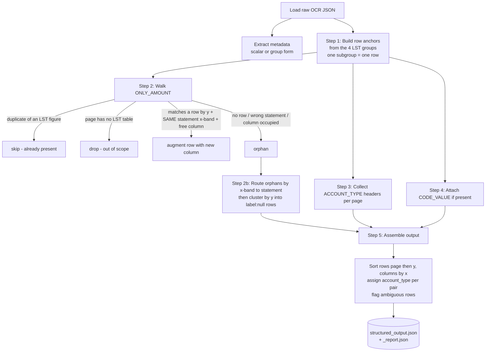

# OCR Financial-Statement Table Reconstruction

**Reconstructing line-by-line, page-by-page financial statements from raw OCR output**

| | |
|---|---|
| **Component** | `structure_ocr.py` |
| **Input** | Raw OCR-provider JSON (e.g. `comprehansive_sample.json`) |
| **Output** | `structured_output.json` + `structured_output_report.json` |
| **Audience** | Python developers & business stakeholders |
| **Status** | Validated on the reference sample (3.4 MB, 11 top-level objects) |
| **Related** | [`Primary_Statement_Classification.md`](Primary_Statement_Classification.md) — Stage 2 (which pages are real statements vs. notes) |

> **Two-stage pipeline.** This document is **Stage 1**: it reconstructs the **tables** (rows,
> columns, account types) from raw OCR for every statement-bearing page. **Stage 2**
> ([`Primary_Statement_Classification.md`](Primary_Statement_Classification.md)) then labels each
> page as a *primary* statement vs. a note or junk page. Stage 1 rebuilds; Stage 2 classifies.

---

## Table of Contents

1. [Executive Summary](#1-executive-summary) *(business)*
2. [Background & Goal](#2-background--goal)
3. [Input Data Model](#3-input-data-model) *(developers)*
4. [Key Discoveries That Shaped the Algorithm](#4-key-discoveries-that-shaped-the-algorithm)
5. [Output Schema](#5-output-schema)
6. [The Algorithm, Step by Step](#6-the-algorithm-step-by-step)
7. [The Hard Part: Columns & Account Types](#7-the-hard-part-columns--account-types)
8. [Edge-Case Handling](#8-edge-case-handling)
9. [The Data-Conservation Guarantee](#9-the-data-conservation-guarantee) *(business + developers)*
10. [Quality Report (Reference Sample)](#10-quality-report-reference-sample)
11. [Known Limitations & `needs_review`](#11-known-limitations--needs_review)
12. [How to Run](#12-how-to-run) *(developers)*
13. [Glossary](#13-glossary)
14. [Appendix: Worked Examples](#14-appendix-worked-examples)

---

## 1. Executive Summary

Financial reports (balance sheets, income statements, cash-flow statements) arrive from our
OCR provider as a large, **flat, unordered** JSON file. The provider recognizes individual
pieces — a line-item name here, a number there, a column header somewhere else — but it does
**not** reassemble them into the tables a human would read.

`structure_ocr.py` rebuilds those tables. For every page it places each recognized element back
into its correct **row** (top-to-bottom) and **column** (left-to-right), reattaches the figures to
their line-item names, and labels every column with the reporting basis it belongs to
(*Controladora* = parent-company / *Consolidado* = consolidated).

**The result** is a clean, predictable JSON in which each of the four financial statements is a
sorted list of rows, and each row carries its label and its values, one per column:

```json
{
  "page_nb": 20,
  "label": "Caixa e equivalentes de caixa",
  "columns": [
    {"account_type": "Controladora", "period": "AMOUNT_N",   "value": "6.886.721"},
    {"account_type": "Controladora", "period": "AMOUNT_N-1", "value": "414.046"},
    {"account_type": "Consolidado",  "period": "AMOUNT_N",   "value": "21.721.393"},
    {"account_type": "Consolidado",  "period": "AMOUNT_N-1", "value": "14.819.906"}
  ]
}
```

**Why this can be trusted.** The transformation is *conservation-checked*: on the reference
document, **every one of the 3,677 figures in scope appears exactly once in the output — zero
loss, zero duplication.** Where the source layout is genuinely ambiguous (a handful of dense
"notes" pages), the affected rows are **explicitly flagged** (`needs_review: true`) rather than
silently guessed. On the reference sample that is **105 of 1,453 rows (≈ 7%)**; the remaining
93% are reconstructed unambiguously.

| Headline metric (reference sample) | Value |
|---|---|
| Financial-statement pages processed | 69 |
| Reconstructed rows | 1,453 |
| Figures (columns) placed | 3,677 |
| Figures lost | **0** |
| Rows flagged for review | 105 (≈ 7%) |

---

## 2. Background & Goal

### 2.1 What the OCR provider gives us

The provider performs **element-level extraction**. It is very good at reading individual tokens
(a word, a monetary amount) and assigning each a **bounding box** — normalized coordinates in the
`[0, 1] × [0, 1]` page space. It is **not** a table-structure engine: it does not know that the
number `6.886.721` is the *Controladora / current-year* value for the row *Caixa e equivalentes
de caixa*. That relationship is implied only by the **geometry** (the number sits on the same
horizontal line as the name, under the *Controladora* header).

### 2.2 What we need

A faithful, machine-readable reconstruction of the **tables as a human sees them on the page**:

- elements grouped into **rows**, ordered **top-to-bottom** within each page;
- within a row, figures ordered **left-to-right** into **columns**;
- each figure tied to its **line-item name**;
- each column tagged with its **reporting basis** (`account_type`) and **period**
  (`AMOUNT_N` = current period, `AMOUNT_N-1` = prior period);
- document-level **metadata** (closing date, currency, unit, duration) carried alongside.

### 2.3 Scope

We reconstruct the four statement families:

`BALANCE_ASSETS_LST`, `BALANCE_LIABILITIES_LST`, `INCOME_STATEMENT_LST`, `CASH_FLOW_LST`

plus the supporting groups that supply missing figures (`ONLY_AMOUNT`), column headers
(`ACCOUNT_TYPE`), and optional row codes (`CODE_VALUE`).

---

## 3. Input Data Model

> **Note on encoding.** The source file is valid **UTF-8** (e.g. `Títulos e valores mobiliários`,
> `31 de março de 2025`). A `�` character seen in a Windows console is a *display* artifact of the
> console code page, **not** a defect in the data or the output.

### 3.1 Top level — a flat list of 11 objects

The root of the JSON is a **list** of 11 objects, of two kinds:

| Kind | Identified by | Role |
|---|---|---|
| **Metadata** | `data_point_name` (scalar) **or** `group_name` (group) ∈ {`CLOSING_DATE`, `DURATION`, `CURRENCY`, `UNIT`} | Document-level facts |
| **Groups** | have `group_name` + `subgroups` | The table data |

> **Metadata comes in two forms.** On the reference sample all four are **scalars** (top-level
> `data_point_name` + `value:{}`). In other documents (e.g. ITR forms, `sample_2.json`) a field such
> as `CLOSING_DATE` arrives as a **group** (`group_name` + `subgroups`) with the value repeated on
> several pages. `extract_metadata` handles both, taking the highest-confidence value (see §3.4).

The seven groups on the reference sample (`comprehansive_sample.json`):

| `group_name` | `subgroups` | Role |
|---|---|---|
| `ACCOUNT_TYPE` | 127 | Column headers (*Controladora* / *Consolidado* / …) |
| `BALANCE_ASSETS_LST` | 92 | Balance sheet — assets |
| `BALANCE_LIABILITIES_LST` | 94 | Balance sheet — liabilities |
| `INCOME_STATEMENT_LST` | 358 | Income statement |
| `CASH_FLOW_LST` | 576 | Cash-flow statement |
| `ONLY_AMOUNT` | 2,489 | **All** figures on the page (see §4) |
| `CODE_VALUE` | 0 | Row codes — **empty here, but populated in other documents** (e.g. ITR forms carry 300 hierarchical codes `1` / `1.01` / `1.01.01`); see §3.5 |

### 3.2 A statement group → `subgroups` → `values`

Each statement group contains `subgroups`. **One `subgroup` corresponds to exactly one visual
row** (verified: in 1,119 of 1,120 LST subgroups the vertical spread of all elements is ≈ 0 — they
sit on the same line). Each `subgroup` has a `page_nb` and a list of `values`. Each `value` carries
the three fields we use — `value`, `label`, `location` — plus provider extras we ignore.

```jsonc
{
  "page_nb": 20,
  "values": [
    {
      "value": "Caixa e equivalentes de caixa",   // the text
      "label": "BALANCE_ASSETS_LST",              // == group name  → this is the row NAME
      "location": { "x_min": 0.160, "x_max": 0.336, "y_min": 0.210, "y_max": 0.221 }
    },
    {
      "value": "6.886.721",
      "label": "AMOUNT_N",                          // current-period figure
      "location": { "x_min": 0.496, "x_max": 0.564, "y_min": 0.210, "y_max": 0.220 }
    },
    {
      "value": "414.046",
      "label": "AMOUNT_N-1",                        // prior-period figure
      "location": { "x_min": 0.625, "x_max": 0.672, "y_min": 0.210, "y_max": 0.220 }
    }
  ]
}
```

**The `label` field is the key discriminator inside a row:**

- `label == <group name>` → the element is the **row name** (the line-item text).
- `label == "AMOUNT_N"` → a **current-period** figure.
- `label == "AMOUNT_N-1"` → a **prior-period** figure.

All elements of one `subgroup` share (approximately) the same `y` — that is what makes a subgroup
a row.

### 3.3 `location` — the coordinate system

```
(0,0) ┌─────────────────────────────┐   x grows →  (left to right)
      │                             │
      │   x_min ──► x_max           │   y grows ↓  (top to bottom)
      │   ┌──────────┐ y_min        │
      │   │  token   │              │   All values are normalized to [0,1].
      │   └──────────┘ y_max        │
      │                             │
      └─────────────────────────────┘ (1,1)
```

We derive two convenience quantities used throughout the algorithm:

- **y-center** = `(y_min + y_max) / 2` → which **row** an element belongs to.
- **x-center** = `(x_min + x_max) / 2` → which **column** an element belongs to.

### 3.4 Metadata — scalar form and group form

**Scalar form** (used by all four fields on the reference sample):

```jsonc
{
  "data_point_name": "DURATION",
  "value": {
    "value": "31 de março de 2025",
    "normalized_value": "31 de março de 2025",
    "page_nb": 93,
    "confidence": 0.9997
  }
}
```

**Group form** (seen in ITR forms and `sample_2.json`, e.g. `CLOSING_DATE`): the field is a normal
group whose `subgroups[].values[]` repeat the same value on several pages.

```jsonc
{
  "group_name": "CLOSING_DATE",
  "subgroups": [
    { "page_nb": 1, "values": [ { "value": "30/06/2025", "normalized_value": "30/06/2025",
                                  "confidence": 0.9999 } ] },
    { "page_nb": 2, "values": [ { "value": "30/06/2025", "confidence": 0.9999 } ] }
    // ... repeated on more pages
  ]
}
```

`extract_metadata` reads **both** forms and keeps the highest-confidence value per field.
On the reference sample: `CLOSING_DATE = "2025"`, `DURATION = "31 de março de 2025"`,
`CURRENCY = "Reais"`, `UNIT = "milhares"`.

> **Note:** OCR sometimes truncates these tokens (e.g. `CURRENCY = "(Reais"`, `UNIT = "Mil)"` in an
> ITR form). The values are passed through as recognized; normalization is an open item.

### 3.5 Row codes (`CODE_VALUE`)

A group of hierarchical row identifiers, **empty on the reference sample but populated in others**
(ITR forms carry 300 codes). Each code sits to the left of the row (x ≈ 0.05) on the row's `y`:

```jsonc
{
  "group_name": "CODE_VALUE",
  "subgroups": [
    { "page_nb": 1, "values": [ { "value": "1",       "location": {"x_min": 0.051, ...} } ] },
    { "page_nb": 1, "values": [ { "value": "1.01",    "location": {"x_min": 0.053, ...} } ] },
    { "page_nb": 1, "values": [ { "value": "1.01.01", "location": {"x_min": 0.053, ...} } ] }
  ]
}
```

When present, `attach_codes` binds each code to the row at the same page and `y` (tolerance
`Y_ROW_TOL = 0.012`); the code appears as a `code` field on the output row (see §5 / §8).

---

## 4. Key Discoveries That Shaped the Algorithm

These four findings are **non-obvious** and each one drove a concrete design decision. They are the
reason the algorithm looks the way it does.

### Discovery 1 — A `subgroup` already *is* a row

In 1,119 of 1,120 LST subgroups, the vertical spread of all elements is ≈ 0. **The provider has
already linked each line-item name to its own figures.** → *We treat the subgroup as a trustworthy
row anchor and only need to **augment** it with missing columns — we do not rebuild rows from
scratch.*

### Discovery 2 — `ONLY_AMOUNT` is **not** a complete superset

It is tempting to assume every figure also lives in `ONLY_AMOUNT`. It does not: **104 LST figures
(≈ 6%)** are absent from `ONLY_AMOUNT` (concentrated on cash-flow pages 156 and 26). →
*Columns must be built as the **union** of LST figures **and** `ONLY_AMOUNT` figures, de-duplicated
by location — never "replace from `ONLY_AMOUNT`".*

### Discovery 3 — A header spans a **pair** of columns, not one

A four-column page has two periods per reporting basis: `AMOUNT_N` and `AMOUNT_N-1`. The header
`Controladora` sits **above the gap between its two columns** and frequently does not even overlap
the first of them.

```
        x:  0.51        0.63              0.75        0.87
            ┌──────┐    ┌──────┐          ┌──────┐    ┌──────┐
  header →      [ Controladora ]              [ Consolidado ]      ← header box spans the PAIR
            │ N    │    │ N-1  │          │ N    │    │ N-1  │
            6.886.721   414.046           21.721.393  14.819.906
```

→ *Headers are matched to a **column-pair** by x-overlap, not to a single column. Fragments that
OCR split (e.g. `resultado` + `consolidado`) are merged **only** when they fall over the same pair.*

### Discovery 4 — A single page can hold several tables

Page 70 contains two independent tables stacked vertically (one near `y ≈ 0.21`, another near
`y ≈ 0.49`), **each** with its own `Controladora` / `Consolidado` headers. → *A column's
`account_type` is taken from the **nearest header above it** (largest `y_header < y_row`), which
correctly separates stacked tables.*

---

## 5. Output Schema

The output is a single JSON object with two top-level keys: `metadata` and `statements`.

```jsonc
{
  "metadata": {
    "CLOSING_DATE": { "value": "2025", "raw": "2025", "page_nb": 139, "confidence": 0.9998 },
    "DURATION":     { "value": "31 de março de 2025", "raw": "...", "page_nb": 93,  "confidence": 0.9997 },
    "CURRENCY":     { "value": "Reais",    "raw": "Reais",    "page_nb": 169, "confidence": 0.9999 },
    "UNIT":         { "value": "milhares", "raw": "milhares", "page_nb": 97,  "confidence": 0.9999 }
  },

  "statements": {
    "BALANCE_ASSETS_LST":      [ <row>, <row>, ... ],
    "BALANCE_LIABILITIES_LST": [ <row>, ... ],
    "INCOME_STATEMENT_LST":    [ <row>, ... ],
    "CASH_FLOW_LST":           [ <row>, ... ]
  }
}
```

### Row object

| Field | Type | Always present | Meaning |
|---|---|---|---|
| `page_nb` | int | yes | Source page (1-based, as provided). |
| `label` | string \| null | yes | Line-item name. `null` when OCR produced figures but no name (see §8). |
| `columns` | array | yes | The figures of this row, ordered left-to-right. May be empty. |
| `code` | string | only if present | Row code from `CODE_VALUE` (absent on the reference sample; present e.g. on ITR forms). |
| `label_missing` | bool | only if `true` | Convenience flag set when `label` is `null`. |
| `needs_review` | bool | only if `true` | Set when column→header assignment is ambiguous (see §11). |
| `y` | float | only with `--debug` | Row y-center, for visual cross-checking. |

### Column object

| Field | Type | Meaning |
|---|---|---|
| `account_type` | string \| null | Reporting basis: `Controladora`, `Consolidado`, … or `null` if the page has no header. |
| `period` | string | `AMOUNT_N` (current) or `AMOUNT_N-1` (prior) — taken **directly** from the source `label`. |
| `value` | string | The figure, exactly as recognized (e.g. `"6.886.721"`, `"(106.057.746)"`). |
| `x` | float | x-center; emitted only with `--debug`. |
| `_match` | string | How `account_type` was assigned (`overlap` / `nearest_x`); `--debug` only. |

Rows are sorted by **(page, y-center ascending)** → top-to-bottom within each page. Columns are
sorted by **x-center ascending** → left-to-right.

---

## 6. The Algorithm, Step by Step



### Step 1 — Build row anchors (`build_row_anchors`)

Iterate the four LST groups. Each `subgroup` becomes one **row anchor**:

```python
row = {
  "statement":  <group name>,         # which of the 4 statements
  "page_nb":    <page>,
  "label":      <name text or None>,  # the value whose label == group name
  "y":          <mean y-center>,      # the row's vertical position
  "name_x_max": <right edge of name>, # used to bind figures that sit to its right
  "amounts":    [ {value, period, loc}, ... ],   # figures already in this subgroup
  "code":       None,
}
```

Simultaneously we record the **location key** `(value, round(x_min,4), round(y_min,4))` of every
LST figure into a per-page set `lst_amount_keys` — this is the de-duplication index for Step 2.

### Step 2 — Augment with `ONLY_AMOUNT` (`augment_with_only_amount`)

Walk every figure in `ONLY_AMOUNT` and route it:

| Condition | Action | Report counter |
|---|---|---|
| Location key already in `lst_amount_keys[page]` | **skip** (it is the same figure already in a row) | `dup_skip` |
| Page has **no** LST table | **drop** (out of scope — notes table) | `drop_non_lst_page` |
| Sum's x overlaps a statement x-band, but **no same-`y` row of that statement** | becomes an **orphan** (x-band gate, §7.3a) | `orphan_xband` |
| A row exists at the same `y` (and correct statement) **and** its column slot is free | **augment** that row with a new column | `augment_row` |
| Same-`y` row exists but the target column is **already occupied** | becomes an **orphan** (occupancy guard, §7.3) | `orphan_occupied` |
| No row at this `y` | becomes an **orphan** | `orphan` |

Row matching uses a vertical tolerance `Y_ROW_TOL = 0.012`. **Statement gate first (§7.3a):** we build
the per-`(page, statement)` x-bands of NAMED columns and, if the figure's x overlaps any band, keep
only candidate rows belonging to those statements — otherwise drop the figure to an orphan rather than
bind it to a wrong-statement neighbour. This is essential on **side-by-side balances** (Ativo left /
Passivo right on the same `y`), where a pure-`y` match silently glues a liability subtotal onto an
assets row (§7.3a). Among the surviving candidates we prefer those whose **name ends to the left** of the
figure (`name_x_max < x_center`), then pick the closest by `y`. The new figure's `period` is copied
**verbatim** from its source `label` — we never guess it.

### Step 2b — Materialize orphans (`materialize_orphans`)

Orphans are figures on an in-scope page that could not bind to any named row — typically rows whose
**name** the OCR failed to read. We first **route each orphan to a statement by x-band** (the statement
whose NAMED-column x-band overlaps the orphan's x — `build_statement_xbands` / `_statement_for_orphan`),
then cluster by `y` (`Y_ORPHAN_TOL = 0.010`) **within that statement** into synthetic rows with
`label = null`. (A pure-`y` cluster that ignored the statement was the original side-by-side bug, §7.3a.)
This satisfies the requirement that **amount-only rows must still appear, in their correct position**.

### Step 3 — Collect headers (`build_account_headers`)

Gather all `ACCOUNT_TYPE` elements on in-scope pages as `{raw, x_min, x_max, y}`. No merging is done
here — merging happens per column-pair in Step 5 (see §7.2 for *why* eager merging is wrong).

### Step 4 — Attach codes (`attach_codes`)

If `CODE_VALUE` is non-empty, bind each code to the row at the same page and `y` (tolerance
`Y_ROW_TOL = 0.012`). Empty on the reference sample, but **exercised on real data**: an ITR form
attached all 300 hierarchical codes (`1` / `1.01` / `1.01.01`), covering 300 of 302 rows — the two
misses are OCR line-wraps that have no own code in the source.

### Step 5 — Assemble (`build_output` → `assign_account_types`)

For each row: sort its figures by x, group them into period-pairs, assign `account_type` per pair
(§7), then emit the row. Finally sort rows by `(page, y)` and route each into its statement bucket.
Rows that ended up without a statement are dropped (counter `dropped_no_statement`).

---

## 7. The Hard Part: Columns & Account Types

This section explains the geometric reasoning that the previous step summarized.

### 7.1 Periods come from labels; columns come from geometry

We **never** infer whether a figure is current or prior from its position — the source `label`
(`AMOUNT_N` / `AMOUNT_N-1`) tells us directly, and it is reliable. Position is used only to order
columns left-to-right and to group them into pairs.

**Pairing rule** (`pair_columns`): scan x-sorted figures; an `AMOUNT_N` immediately followed by an
`AMOUNT_N-1` forms a **pair**; anything else stands alone. On clean pages this yields the canonical
`N, N-1, N, N-1` sequence — verified on pages 20 and 70.

### 7.2 Why headers must **not** be merged by `y` alone

Two header tokens on the same line can be either *one* phrase or *two* separate headers — only x
tells them apart:

```
Page 20  (TWO separate headers, same y):
   'Controladora'  x[0.591–0.678]      'Consolidado'  x[0.825–0.906]
        └─ over pair (0.51, 0.63)            └─ over pair (0.75, 0.87)

Page 64  (ONE phrase split by OCR, same y, touching):
   'resultado'  x[0.805–0.855] + 'consolidado'  x[0.857–0.918]   →  "resultado consolidado"
        └────────────── both over the SAME pair ──────────────┘
```

Merging by `y` would wrongly fuse the page-20 headers. Therefore we **assign first, merge second**:
each header is tested against a *column-pair*, and only the fragments that land on the **same pair**
are concatenated.

### 7.3 Assigning `account_type` to a pair (`assign_account_types`)

For each column-pair with x-span `[span_min, span_max]`:

1. **Candidates = headers above the row** (`y_header < y_row`). This is what separates the two
   tables on page 70 — a row only ever looks *upward* for its header.
2. Keep headers whose x-range **overlaps** the pair's span.
3. Among the overlapping headers, take the **top-most line** (largest `y`), concatenate its
   fragments left-to-right, and **normalize** (§7.4). → `_match = "overlap"` (the confident path:
   1,870 columns on the sample).
4. **Fallback** — if no header overlaps but headers exist above, attach the one **closest in x**.
   → `_match = "nearest_x"` (415 columns). This is a best-effort guess on irregular layouts.
5. If the page has **no** headers at all, `account_type = null` (single-basis page, 782 columns).

```
          Row at y_row = 0.215  →  looks UPWARD only
          ┌─────────────────────────────────────────────┐
   y=0.17 │  [Controladora]            [Consolidado]     │  ← nearest headers ABOVE
          │        ⇓                        ⇓             │
   y=0.215│  N=6.886.721 N-1=414.046  N=21.721.393 N-1=14.819.906
          │  └── pair → Controladora ─┘ └── pair → Consolidado ──┘
          └─────────────────────────────────────────────┘
```

### 7.3a Statement x-band gate (side-by-side balances)

A second geometric guard, distinct from occupancy (§7.3). Some balances print **two statements
side by side** — Ativo on the left (x≈0.33-0.44), Passivo + Patrimônio Líquido on the right
(x≈0.82-0.95) — on the **same physical rows** (one shared `y`). A figure-to-row match by `y` alone
will therefore happily bind a *liability* subtotal onto an *assets* row (and vice versa), because a
named row of the other statement sits at the same height.

The fix: before binding, build the per-`(page, statement)` x-band of NAMED amount columns
(`build_statement_xbands`). When an `ONLY_AMOUNT` figure's x overlaps any statement's band, restrict
its candidate rows to those statements; if that leaves no same-`y` row, drop the figure to an orphan
(`orphan_xband`) rather than glue it onto a wrong-statement neighbour. The **same** x-band routing is
then applied in Step 2b (`materialize_orphans` / `_statement_for_orphan`).

⚠️ Both stages must apply the gate. The routing originally lived only in `materialize_orphans`
(Step 2b); leaving `augment_with_only_amount` (Step 2) on a pure-`y` rule meant it ran **first**,
glued cross-statement figures as spurious extra columns, **and** corrupted the very named-column
x-bands that Step 2b depends on — cascading the error. Symptom on `complicated_sample_2`: the three
liability empty-label subtotals (current 22.168.649,61 / non-current 2.739.236,61 / equity
49.766.376,21) were lost or misrouted while all assets subtotals survived. Conservation still passed
(figure **count** unchanged) — see §9 on why count ≠ correctness.

### 7.4 Normalization (`normalize_account_type`)

OCR yields case/spelling variants (`Consolidado`, `consolidado`, `Consolidados`, `consolidada`).
We canonicalize by keyword: `*controladora*` → **Controladora**, `*consolidad*` → **Consolidado**,
`*individual*` → **Individual**; anything else is kept trimmed and readable (e.g. *Resultado*,
*Média ponderada*).

---

## 8. Edge-Case Handling

| Case | Source signal | Handling |
|---|---|---|
| **Name-only row** (no figures) | LST subgroup with a single name value | Kept as a row with `columns: []`. The line item is preserved in its position. |
| **Amount-only row** (no name) | `ONLY_AMOUNT` figures with no named row at that `y` | Clustered into a `label: null` row (`label_missing: true`), positioned by `y`. |
| **Missing second basis** (e.g. *Títulos*) | Only the *Consolidado* cells were printed | Only the present columns are emitted — no fabricated `Controladora` cells. |
| **`ONLY_AMOUNT` is incomplete** | ≈ 6% of LST figures absent there | Union of both sources guarantees they are still emitted (Discovery 2). |
| **Multiple tables per page** | Several header sets at different `y` | "Nearest header above" routes each row to the right table (Discovery 4). |
| **Non-standard column count** (3/5/6) | Irregular notes layout | Pairing is left-to-right; an unpaired column is matched as a single. |
| **Out-of-scope figures** | Figures on pages with no LST table | Dropped (counter `drop_non_lst_page`), reported, never silently mixed in. |
| **`CODE_VALUE` present** | Non-empty group (e.g. ITR forms, 300 codes) | Codes bound to rows by page + `y`; branch inert when the group is empty. |
| **Stacked sub-tables collide** | One `y`-band crosses several mini-tables | Occupancy guard re-routes the colliding figure to an orphan; residual ambiguity is flagged (§11). |

---

## 9. The Data-Conservation Guarantee

The single most important property for trusting the output: **no figure is silently lost or
duplicated.** Every monetary value in scope is accounted for by an exact identity, which we verify
programmatically.

**Identity A — every `ONLY_AMOUNT` figure has a destination:**

```
ONLY_AMOUNT figures (4,386)
   = dup_skip (1,548)          → already present as an LST figure
   + augment_row (996)         → added as a new column
   + orphan (951)              → became a label:null row
   + orphan_occupied (78)      → re-routed by the occupancy guard (§7.3)
   + orphan_xband (…)          → re-routed by the statement x-band gate (§7.3a)
   + drop_non_lst_page (813)   → out of scope (reported)
   ──────────────────────────
   = 4,386  ✓
```

(`orphan_xband` is 0 on this reference sample — it is non-zero on side-by-side balances such as
`complicated_sample_2`. Each such figure still becomes a `label:null` column, so the identity holds.)

> ⚠️ **Conservation checks COUNT, not CORRECTNESS of attachment.** These identities prove no figure
> is lost or duplicated — they do **not** prove each figure landed on the right row/statement. A
> side-by-side balance that glued a liability sum onto an assets row (the §7.3a bug) still satisfied
> all three identities. Geometric correctness is guarded separately (§7.3, §7.3a) and residual
> ambiguity is flagged `needs_review` (§11).

**Identity B — every output column traces back to a real source figure:**

```
Output columns (3,677)
   = LST own figures (1,652)
   + augmented from ONLY_AMOUNT (996)
   + orphans materialized as columns (951 + 78 = 1,029)
   ──────────────────────────
   = 3,677  ✓
```

**Identity C — input equals output on in-scope pages:** the set of unique amounts (union of LST +
`ONLY_AMOUNT`, de-duplicated by location) on the 69 in-scope pages contains exactly **3,677**
figures, equal to the output column count. **Difference: 0.**

These identities are not assumed — they are recomputed from the input and the report every run, and
any drift would be visible immediately.

---

## 10. Quality Report (Reference Sample)

Produced as `structured_output_report.json` on every run.

### Coverage

| Metric | Value |
|---|---|
| In-scope (LST) pages | 69 |
| Rows — total | 1,453 |
| &nbsp;&nbsp;• with a recognized label | 1,120 |
| &nbsp;&nbsp;• `label: null` (amount-only) | 333 |
| Columns (figures placed) | 3,677 |

### `ONLY_AMOUNT` routing

| Bucket | Count | Meaning |
|---|---|---|
| `dup_skip` | 1,548 | Duplicate of an LST figure |
| `augment_row` | 996 | Added as a new column to an existing row |
| `orphan` | 951 | No host row → became a `label:null` row |
| `orphan_occupied` | 78 | Column slot taken → re-routed by occupancy guard |
| `drop_non_lst_page` | 813 | Out of scope (notes pages) |
| `ambiguous_statement` | 5 | Same-`y` rows from >1 statement (logged) |

### `account_type` assignment

| Path | Columns | Confidence |
|---|---|---|
| `overlap` | 1,870 | High — header x-range covers the pair |
| `nearest_x` | 415 | Best-effort — closest header above |
| `null` (no header on page) | 782 | Single-basis page |

### Integrity

| Metric | Value |
|---|---|
| Figures lost | **0** |
| Rows flagged `needs_review` | 105 (≈ 7%) |

---

## 11. Known Limitations & `needs_review`

### What gets flagged

A row is marked `needs_review: true` when, after assignment, the **same `(account_type, period)`
appears more than once** in it — a logical impossibility for a single well-formed table row, and
therefore a reliable signal that the row's geometry was ambiguous.

### Why it happens (and why it is largely intrinsic)

These rows concentrate on a small number of dense **notes pages**:

| Page | Flagged rows |
|---|---|
| 132 | 25 |
| 51 | 18 |
| 138 | 14 |
| 4 | 13 |
| 82 | 8 |
| others | ~27 |

On such a page, several **independent sub-tables are stacked vertically** (page 51 has up to 8
distinct x-bands of figures) while only **two** column headers exist for the whole page. A single
horizontal `y`-band then legitimately crosses unrelated sub-tables, so any purely geometric method
will over-collect columns. **Two headers cannot describe eight columns** — this is an intrinsic
ambiguity of the source layout, not a coding defect.

### What the algorithm does about it

1. **Occupancy guard** — prevents two figures from being stacked into one visual column; this alone
   removed the clear errors (mis-paired rows fell from 123 → 105).
2. **Explicit flag** — the residual ambiguous rows carry `needs_review: true` instead of emitting a
   confident-looking but wrong pairing. **All figures are still present** (conservation holds); only
   their column assignment is uncertain.

### Recommended next steps (optional)

- **Sub-table segmentation:** split a flagged page into vertical x-clusters and match headers per
  cluster — would resolve most of the 105.
- **Visual QA aid:** render the ~15 affected pages to HTML/CSV for fast human verification.

---

## 12. How to Run

**Requirements:** Python 3.13 (standard library only — no third-party packages).

```bash
# Default: reads comprehansive_sample.json, writes structured_output.json (+ _report.json)
python3.13 structure_ocr.py

# Explicit input/output
python3.13 structure_ocr.py path/to/input.json -o path/to/output.json

# Debug mode: also emit x / y coordinates and the account_type match path,
# for visual cross-checking against the original PDF.
python3.13 structure_ocr.py --debug
```

**CLI parameters**

| Argument | Default | Description |
|---|---|---|
| `input` (positional) | `comprehansive_sample.json` | Raw OCR JSON to process. |
| `-o`, `--output` | `structured_output.json` | Output path. The report is written next to it as `<name>_report.json`. |
| `--debug` | off | Add `x`, `y`, `_match` fields for inspection. |

**Outputs**

- `structured_output.json` — the reconstructed statements + metadata (§5).
- `structured_output_report.json` — the quality counters (§10).

**Tuning constants** (top of `structure_ocr.py`)

| Constant | Value | Controls |
|---|---|---|
| `Y_ROW_TOL` | `0.012` | Vertical tolerance for "same row" when binding figures. |
| `Y_ORPHAN_TOL` | `0.010` | Vertical tolerance when clustering orphan figures into rows. |

> The console prints the report in Russian/UTF-8; the script forces UTF-8 stdout so non-ASCII text
> renders correctly regardless of the Windows console code page.

---

## 13. Glossary

| Term | Meaning |
|---|---|
| **Element / token** | A single OCR-recognized item (a word or a number) with a bounding box. |
| **`subgroup`** | A provider grouping that corresponds to one visual table row. |
| **Row anchor** | Our internal representation of a row, seeded from an LST `subgroup`. |
| **`AMOUNT_N` / `AMOUNT_N-1`** | Current-period / prior-period figure (the **period**). |
| **`account_type`** | Reporting basis of a column: **Controladora** (parent company) or **Consolidado** (consolidated). |
| **Column-pair** | The `(AMOUNT_N, AMOUNT_N-1)` couple belonging to one reporting basis. |
| **Orphan** | An `ONLY_AMOUNT` figure that could not bind to a named row. |
| **In-scope page** | A page containing at least one of the four LST statements. |
| **Conservation** | The guarantee that input figures = output figures (no loss/duplication). |
| **`needs_review`** | Flag marking a row whose column→header assignment is ambiguous. |
| **`x-center` / `y-center`** | Bounding-box midpoints, used to assign columns / rows. |
| **Controladora / Consolidado** | Parent-only vs. group-consolidated financial figures (Portuguese). |

---

## 14. Appendix: Worked Examples

### Example A — Page 20, `BALANCE_ASSETS_LST`: a clean 4-column row

**Source** (`Caixa e equivalentes de caixa`): the LST subgroup supplies the name + the two
*Controladora* figures; `ONLY_AMOUNT` supplies the two *Consolidado* figures (which the LST group
does not carry).

```
x:      0.16….0.34         0.53        0.65          0.75          0.87
        Caixa e equiv…   6.886.721    414.046      21.721.393    14.819.906
                          (LST)        (LST)         (ONLY_AMOUNT)  (ONLY_AMOUNT)
header:                  └─ Controladora ─┘          └─ Consolidado ─┘
```

**Output:**

```json
{
  "page_nb": 20,
  "label": "Caixa e equivalentes de caixa",
  "columns": [
    {"account_type": "Controladora", "period": "AMOUNT_N",   "value": "6.886.721"},
    {"account_type": "Controladora", "period": "AMOUNT_N-1", "value": "414.046"},
    {"account_type": "Consolidado",  "period": "AMOUNT_N",   "value": "21.721.393"},
    {"account_type": "Consolidado",  "period": "AMOUNT_N-1", "value": "14.819.906"}
  ]
}
```

The next row on that page, *Títulos e valores mobiliários*, has **only** the *Consolidado* cells
printed (its *Controladora* slots are blank). The output therefore contains just two columns, both
`Consolidado` — no fabricated values.

### Example B — Page 70, `INCOME_STATEMENT_LST`: two tables on one page

Page 70 stacks two independent tables, each with its own `Controladora` / `Consolidado` headers
(at `y ≈ 0.21` and `y ≈ 0.49`). A row in the **lower** table (e.g. `y ≈ 0.55`) looks upward and
correctly binds to the **lower** header set — not the page-top one. Both tables reconstruct as
clean four-column rows, confirming that the "nearest header above" rule separates stacked tables.

```
y≈0.21   [Controladora]   [Consolidado]      ← header set 1
y≈0.25   2.453.721 3.016.793  5.103.696 5.489.178   (table 1 rows)
   …
y≈0.49   [Controladora]   [Consolidado]      ← header set 2
y≈0.53   2.173.139 2.831.446  7.753.401 9.575.879   (table 2 rows → use header set 2)
```

---

*Document generated for the `br_ocr_json_processing` project. The algorithm and every figure in
this document are reproducible by running `python3.13 structure_ocr.py --debug` against the
reference sample.*
