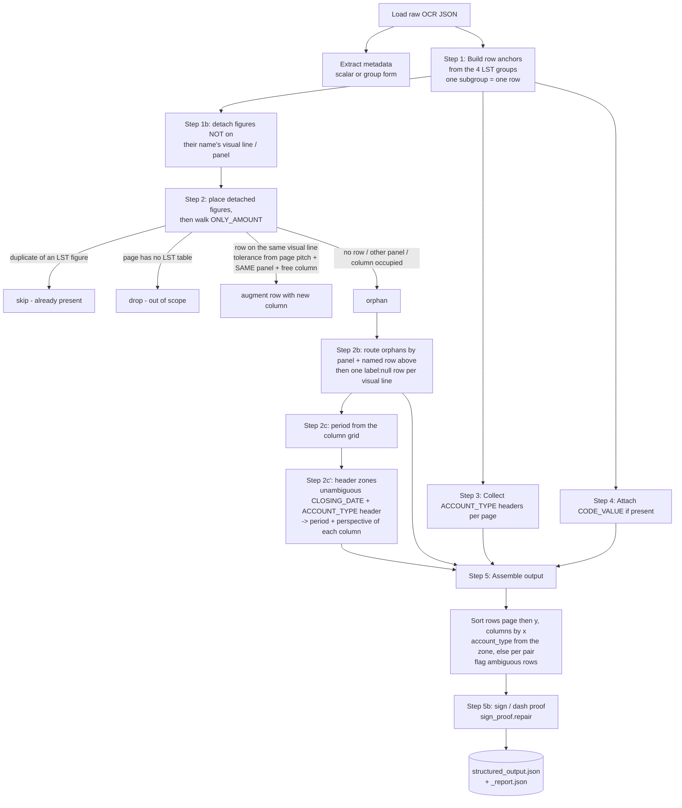

# OCR Financial-Statement Table Reconstruction

**Reconstructing line-by-line, page-by-page financial statements from raw OCR output**

| | |
|---|---|
| **Component** | `structure_ocr.py` |
| **Input** | Raw OCR-provider JSON (e.g. `comprehansive_sample.json`) |
| **Output** | `structured_output.json` + `structured_output_report.json` |
| **Audience** | Python developers & business stakeholders |
| **Status** | Validated on the reference sample (3.4 MB, 11 top-level objects) |
| **Related** | [`Primary_Statement_Classification.md`](Primary_Statement_Classification.md) — Stage 2 (which pages are real statements vs. notes) |

> **Two-stage pipeline.** This document is **Stage 1**: it reconstructs the **tables** (rows,
> columns, account types) from raw OCR for every statement-bearing page. **Stage 2**
> ([`Primary_Statement_Classification.md`](Primary_Statement_Classification.md)) then labels each
> page as a *primary* statement vs. a note or junk page. Stage 1 rebuilds; Stage 2 classifies.

---

## Table of Contents

1. [Executive Summary](#1-executive-summary) *(business)*
2. [Background & Goal](#2-background--goal)
3. [Input Data Model](#3-input-data-model) *(developers)*
4. [Key Discoveries That Shaped the Algorithm](#4-key-discoveries-that-shaped-the-algorithm)
5. [Output Schema](#5-output-schema)
6. [The Algorithm, Step by Step](#6-the-algorithm-step-by-step)
7. [The Hard Part: Columns & Account Types](#7-the-hard-part-columns--account-types)
8. [Edge-Case Handling](#8-edge-case-handling)
9. [The Data-Conservation Guarantee](#9-the-data-conservation-guarantee) *(business + developers)*
10. [Quality Report (Reference Sample)](#10-quality-report-reference-sample)
11. [Known Limitations & `needs_review`](#11-known-limitations--needs_review)
12. [How to Run](#12-how-to-run) *(developers)*
13. [Glossary](#13-glossary)
14. [Appendix: Worked Examples](#14-appendix-worked-examples)

---

## 1. Executive Summary

Financial reports (balance sheets, income statements, cash-flow statements) arrive from our
OCR provider as a large, **flat, unordered** JSON file. The provider recognizes individual
pieces — a line-item name here, a number there, a column header somewhere else — but it does
**not** reassemble them into the tables a human would read.

`structure_ocr.py` rebuilds those tables. For every page it places each recognized element back
into its correct **row** (top-to-bottom) and **column** (left-to-right), reattaches the figures to
their line-item names, and labels every column with the reporting basis it belongs to
(*Controladora* = parent-company / *Consolidado* = consolidated).

**The result** is a clean, predictable JSON in which each of the four financial statements is a
sorted list of rows, and each row carries its label and its values, one per column:

```json
{
  "page_nb": 20,
  "label": "Caixa e equivalentes de caixa",
  "columns": [
    {"account_type": "Controladora", "period": "AMOUNT_N",   "value": "6.886.721"},
    {"account_type": "Controladora", "period": "AMOUNT_N-1", "value": "414.046"},
    {"account_type": "Consolidado",  "period": "AMOUNT_N",   "value": "21.721.393"},
    {"account_type": "Consolidado",  "period": "AMOUNT_N-1", "value": "14.819.906"}
  ]
}
```

**Why this can be trusted.** The transformation is *conservation-checked*: on the reference
document, **every one of the 3,677 figures in scope appears exactly once in the output — zero
loss, zero duplication.** Where the source layout is genuinely ambiguous (a handful of dense
"notes" pages), the affected rows are **explicitly flagged** (`needs_review: true`) rather than
silently guessed. On the reference sample that is **105 of 1,453 rows (≈ 7%)**; the remaining
93% are reconstructed unambiguously.

| Headline metric (reference sample) | Value |
|---|---|
| Financial-statement pages processed | 69 |
| Reconstructed rows | 1,453 |
| Figures (columns) placed | 3,677 |
| Figures lost | **0** |
| Rows flagged for review | 105 (≈ 7%) |

---

## 2. Background & Goal

### 2.1 What the OCR provider gives us

The provider performs **element-level extraction**. It is very good at reading individual tokens
(a word, a monetary amount) and assigning each a **bounding box** — normalized coordinates in the
`[0, 1] × [0, 1]` page space. It is **not** a table-structure engine: it does not know that the
number `6.886.721` is the *Controladora / current-year* value for the row *Caixa e equivalentes
de caixa*. That relationship is implied only by the **geometry** (the number sits on the same
horizontal line as the name, under the *Controladora* header).

### 2.2 What we need

A faithful, machine-readable reconstruction of the **tables as a human sees them on the page**:

- elements grouped into **rows**, ordered **top-to-bottom** within each page;
- within a row, figures ordered **left-to-right** into **columns**;
- each figure tied to its **line-item name**;
- each column tagged with its **reporting basis** (`account_type`) and **period**
  (`AMOUNT_N` = current period, `AMOUNT_N-1` = prior period);
- document-level **metadata** (closing date, currency, unit, duration) carried alongside.

### 2.3 Scope

We reconstruct the four statement families:

`BALANCE_ASSETS_LST`, `BALANCE_LIABILITIES_LST`, `INCOME_STATEMENT_LST`, `CASH_FLOW_LST`

plus the supporting groups that supply missing figures (`ONLY_AMOUNT`), column headers
(`ACCOUNT_TYPE`), and optional row codes (`CODE_VALUE`).

---

## 3. Input Data Model

> **Note on encoding.** The source file is valid **UTF-8** (e.g. `Títulos e valores mobiliários`,
> `31 de março de 2025`). A `�` character seen in a Windows console is a *display* artifact of the
> console code page, **not** a defect in the data or the output.

### 3.1 Top level — a flat list of 11 objects

The root of the JSON is a **list** of 11 objects, of two kinds:

| Kind | Identified by | Role |
|---|---|---|
| **Metadata** | `data_point_name` (scalar) **or** `group_name` (group) ∈ {`CLOSING_DATE`, `DURATION`, `CURRENCY`, `UNIT`} | Document-level facts |
| **Groups** | have `group_name` + `subgroups` | The table data |

> **Metadata comes in two forms.** On the reference sample all four are **scalars** (top-level
> `data_point_name` + `value:{}`). In other documents (e.g. ITR forms, `sample_2.json`) a field such
> as `CLOSING_DATE` arrives as a **group** (`group_name` + `subgroups`) with the value repeated on
> several pages. `extract_metadata` handles both, taking the highest-confidence value (see §3.4).

The seven groups on the reference sample (`comprehansive_sample.json`):

| `group_name` | `subgroups` | Role |
|---|---|---|
| `ACCOUNT_TYPE` | 127 | Column headers (*Controladora* / *Consolidado* / …) |
| `BALANCE_ASSETS_LST` | 92 | Balance sheet — assets |
| `BALANCE_LIABILITIES_LST` | 94 | Balance sheet — liabilities |
| `INCOME_STATEMENT_LST` | 358 | Income statement |
| `CASH_FLOW_LST` | 576 | Cash-flow statement |
| `ONLY_AMOUNT` | 2,489 | **All** figures on the page (see §4) |
| `CODE_VALUE` | 0 | Row codes — **empty here, but populated in other documents** (e.g. ITR forms carry 300 hierarchical codes `1` / `1.01` / `1.01.01`); see §3.5 |

### 3.2 A statement group → `subgroups` → `values`

Each statement group contains `subgroups`. **One `subgroup` corresponds to exactly one visual
row** (verified: in 1,119 of 1,120 LST subgroups the vertical spread of all elements is ≈ 0 — they
sit on the same line). Each `subgroup` has a `page_nb` and a list of `values`. Each `value` carries
the three fields we use — `value`, `label`, `location` — plus provider extras we ignore.

```jsonc
{
  "page_nb": 20,
  "values": [
    {
      "value": "Caixa e equivalentes de caixa",   // the text
      "label": "BALANCE_ASSETS_LST",              // == group name  → this is the row NAME
      "location": { "x_min": 0.160, "x_max": 0.336, "y_min": 0.210, "y_max": 0.221 }
    },
    {
      "value": "6.886.721",
      "label": "AMOUNT_N",                          // current-period figure
      "location": { "x_min": 0.496, "x_max": 0.564, "y_min": 0.210, "y_max": 0.220 }
    },
    {
      "value": "414.046",
      "label": "AMOUNT_N-1",                        // prior-period figure
      "location": { "x_min": 0.625, "x_max": 0.672, "y_min": 0.210, "y_max": 0.220 }
    }
  ]
}
```

**The `label` field is the key discriminator inside a row:**

- `label == <group name>` → the element is the **row name** (the line-item text).
- `label == "AMOUNT_N"` → a **current-period** figure.
- `label == "AMOUNT_N-1"` → a **prior-period** figure.

All elements of one `subgroup` share (approximately) the same `y` — that is what makes a subgroup
a row.

### 3.3 `location` — the coordinate system

```
(0,0) ┌─────────────────────────────┐   x grows →  (left to right)
      │                             │
      │   x_min ──► x_max           │   y grows ↓  (top to bottom)
      │   ┌──────────┐ y_min        │
      │   │  token   │              │   All values are normalized to [0,1].
      │   └──────────┘ y_max        │
      │                             │
      └─────────────────────────────┘ (1,1)
```

We derive two convenience quantities used throughout the algorithm:

- **y-center** = `(y_min + y_max) / 2` → which **row** an element belongs to.
- **x-center** = `(x_min + x_max) / 2` → which **column** an element belongs to.

### 3.4 Metadata — scalar form and group form

**Scalar form** (used by all four fields on the reference sample):

```jsonc
{
  "data_point_name": "DURATION",
  "value": {
    "value": "31 de março de 2025",
    "normalized_value": "31 de março de 2025",
    "page_nb": 93,
    "confidence": 0.9997
  }
}
```

**Group form** (seen in ITR forms and `sample_2.json`, e.g. `CLOSING_DATE`): the field is a normal
group whose `subgroups[].values[]` repeat the same value on several pages.

```jsonc
{
  "group_name": "CLOSING_DATE",
  "subgroups": [
    { "page_nb": 1, "values": [ { "value": "30/06/2025", "normalized_value": "30/06/2025",
                                  "confidence": 0.9999 } ] },
    { "page_nb": 2, "values": [ { "value": "30/06/2025", "confidence": 0.9999 } ] }
    // ... repeated on more pages
  ]
}
```

`extract_metadata` reads **both** forms and keeps the highest-confidence value per field.
On the reference sample: `CLOSING_DATE = "2025"`, `DURATION = "31 de março de 2025"`,
`CURRENCY = "Reais"`, `UNIT = "milhares"`.

> **Normalization (`normalize_metadata`, 2026-11).** OCR truncates these tokens (`CURRENCY = "(Reais"` /
> `"reais)"` / `"REAL"`, `UNIT = "Mil)"`, `CLOSING_DATE = "2025"` or Serasa's `"C-31/12/2024"`). `value`
> stays as recognized; a `normalized` value is added next to it: `CLOSING_DATE` → ISO date (a bare year —
> or a year older than the period text — is completed from the LATEST date of `DURATION`,
> `normalized_from: "DURATION"`: Romagnole's `"2024"` is the comparative year, the statements are at
> 31/12/2025), `CURRENCY` → `BRL`, `UNIT` → multiplier (1 / 1.000 / 1.000.000), `DURATION` →
> `normalized_months` when it states a date range (`01/01/2025 à 30/06/2025` → 6). With the optional
> words layer, a missing Serasa `DURATION` comes from its «Observações» (`COMPREENDE 09 MES(ES)`).
>
> **Added by the audit fixes (2026-11-04, P14):** a month-year closing date (`"12.2024"`) → the last day of
> that month; `normalized_months` also from an explicit count («09 meses», «nove meses», «trimestre»,
> «semestre») or from two dates with the **same day and month one year apart** («31 de dezembro de 2024 e
> 2023», «… e 31 de dezembro de 2023» = the annual comparison → 12). A single date («31 DE DEZEMBRO DE 2023»)
> or two different day-months («31 de março de 2026 e 31 de dezembro de 2025» = an interim balance against
> the year-end) state no period length and are left alone — a 9-month report can end on 31/12. A missing
> `UNIT` is inferred as 1 only from figures with centavos (Step 4c); the currency is never inferred.
>
> **Added 2026-11-05 (audit Cibra m3):** the document's own typo «31 DE DEZEMBRO **E** 2024 E 2023» («e» for
> «de» between the month and the year, `_DATE_TXT`) reads as «31 de dezembro de 2024 e 2023» → 12 months;
> with the months known, the Excel AMOUNT_N-1 header carries its date (31/12/2023, «12m to 31/12/2023»).

### 3.5 Row codes (`CODE_VALUE`)

A group of hierarchical row identifiers, **empty on the reference sample but populated in others**
(ITR forms carry 300 codes). Each code sits to the left of the row (x ≈ 0.05) on the row's `y`:

```jsonc
{
  "group_name": "CODE_VALUE",
  "subgroups": [
    { "page_nb": 1, "values": [ { "value": "1",       "location": {"x_min": 0.051, ...} } ] },
    { "page_nb": 1, "values": [ { "value": "1.01",    "location": {"x_min": 0.053, ...} } ] },
    { "page_nb": 1, "values": [ { "value": "1.01.01", "location": {"x_min": 0.053, ...} } ] }
  ]
}
```

When present, `attach_codes` binds each code to the row at the same page and `y` (tolerance
`Y_ROW_TOL = 0.012`); the code appears as a `code` field on the output row (see §5 / §8).

---

## 4. Key Discoveries That Shaped the Algorithm

These four findings are **non-obvious** and each one drove a concrete design decision. They are the
reason the algorithm looks the way it does.

### Discovery 1 — A `subgroup` already *is* a row

In 1,119 of 1,120 LST subgroups, the vertical spread of all elements is ≈ 0. **The provider has
already linked each line-item name to its own figures.** → *We treat the subgroup as a trustworthy
row anchor and only need to **augment** it with missing columns — we do not rebuild rows from
scratch.*

### Discovery 2 — `ONLY_AMOUNT` is **not** a complete superset

It is tempting to assume every figure also lives in `ONLY_AMOUNT`. It does not: **104 LST figures
(≈ 6%)** are absent from `ONLY_AMOUNT` (concentrated on cash-flow pages 156 and 26). →
*Columns must be built as the **union** of LST figures **and** `ONLY_AMOUNT` figures, de-duplicated
by location — never "replace from `ONLY_AMOUNT`".*

### Discovery 3 — A header spans a **pair** of columns, not one

A four-column page has two periods per reporting basis: `AMOUNT_N` and `AMOUNT_N-1`. The header
`Controladora` sits **above the gap between its two columns** and frequently does not even overlap
the first of them.

```
        x:  0.51        0.63              0.75        0.87
            ┌──────┐    ┌──────┐          ┌──────┐    ┌──────┐
  header →      [ Controladora ]              [ Consolidado ]      ← header box spans the PAIR
            │ N    │    │ N-1  │          │ N    │    │ N-1  │
            6.886.721   414.046           21.721.393  14.819.906
```

→ *Headers are matched to a **column-pair** by x-overlap, not to a single column. Fragments that
OCR split (e.g. `resultado` + `consolidado`) are merged **only** when they fall over the same pair.*

### Discovery 4 — A single page can hold several tables

Page 70 contains two independent tables stacked vertically (one near `y ≈ 0.21`, another near
`y ≈ 0.49`), **each** with its own `Controladora` / `Consolidado` headers. → *A column's
`account_type` is taken from the **nearest header above it** (largest `y_header < y_row`), which
correctly separates stacked tables.*

### Discoveries 5-9 — from the PDF verification (reciTAL agent `Brazil_OCR202606_V4`, 22 PDFs, 2026-11)

Checked against the page images and the OCR **words** layer (`GET /files/{id}/words/`, the full page
text with the same boxes as the extracted values). Each finding is measured by `harness/run.py`.

| # | Finding | Fix (step) |
|---|---|---|
| 5 | The old fixed `Y_ROW_TOL = 0.012` was **larger than one line**: same-line spread p99 ≤ 0.0017, but the line pitch goes down to 0.0079 (Raízen p26, the primary cash flow). A figure of an unnamed line was glued onto its named neighbour and the real figure of that row went to `label_null` (cascade); orphan figures of adjacent lines chained into one row (16 figures in one row on the DVA, p27). | Tolerance = 0.45 × the page's own line pitch (§6 Step 2); orphan clusters bounded from their top member, never two figures in the same column (Step 2b). |
| 6 | "One subgroup = one row" (Discovery 1) is **not always true** on dense pages: the provider binds the name of line *k* to the figures of line *k ± 1* (DUTRA p2: three income lines carried their neighbour's figures; Raízen p26). | Step 1b re-places such figures on their own visual line. |
| 7 | The `AMOUNT_N` / `AMOUNT_N-1` tag is **wrong in rows with empty cells** (Raízen p26: 15 Controladora-2025 figures tagged N-1, proven by the cash arithmetic) and a **single-value ONLY_AMOUNT subgroup is always tagged `AMOUNT_N`** whatever its column. | Step 2c: period from the right-aligned column grid (user decision 2026-11-04: the column wins over the tag, flagged `period_corrected`). |
| 8 | Statement x-bands built from the provider's statement tags are blind on **side-by-side** pages (LST carries only the first column pair, so the Consolidado columns are in no band — ALUBAR p6) and harmful on **single-panel** pages whose rows the provider tags into two statements (a cash flow with `BALANCE_*` rows — Romagnole p11). | The gate is the physical **panel** of the page, found from the columns of names (Steps 2, 2b). |
| 9 | A name printed over two lines is two subgroups; the figures sit on the last line (DFP) or on the first (ITR), so the row with figures carried a **fragment** (`da contribuição social` → mislabelled as income tax). | Step 4b merges the lines (`label_parts` keeps them). |
| 10 | (audit 2026-11-05, Cibra 12.2024.) Tags of **unnamed** figures (`ONLY_AMOUNT`) are the unreliable ones. Agent 5485 paired two figures across an **empty column**: Contr. 2023 got `N`, Conso 2023 got `N-1`. Those pairs were the only «full rows» of the panel, so Step 2c repainted the whole correct Contr. 2023 column `N`, and the pair rule (Step 5) put Contr. 2023 into Conso 2024. Agent 6051's single-value subgroups carry `N-1` in the Conso 2024 column; Step 2c ignores singles, so nothing corrected them. Meanwhile the **table header says whose column it is**: reciTAL returns `CLOSING_DATE` frames over the N columns and `ACCOUNT_TYPE` frames over the pairs. | Step 2c' — header zones: where the header is unambiguous, period and perspective come from the zone of the figure's column (user decision 2026-11-05). |

---

## 5. Output Schema

The output is a single JSON object with two top-level keys: `metadata` and `statements`.

```jsonc
{
  "metadata": {
    "CLOSING_DATE": { "value": "2025", "raw": "2025", "page_nb": 139, "confidence": 0.9998 },
    "DURATION":     { "value": "31 de março de 2025", "raw": "...", "page_nb": 93,  "confidence": 0.9997 },
    "CURRENCY":     { "value": "Reais",    "raw": "Reais",    "page_nb": 169, "confidence": 0.9999 },
    "UNIT":         { "value": "milhares", "raw": "milhares", "page_nb": 97,  "confidence": 0.9999 }
  },

  "statements": {
    "BALANCE_ASSETS_LST":      [ <row>, <row>, ... ],
    "BALANCE_LIABILITIES_LST": [ <row>, ... ],
    "INCOME_STATEMENT_LST":    [ <row>, ... ],
    "CASH_FLOW_LST":           [ <row>, ... ]
  }
}
```

### Row object

| Field | Type | Always present | Meaning |
|---|---|---|---|
| `page_nb` | int | yes | Source page (1-based, as provided). |
| `label` | string \| null | yes | Line-item name. `null` when OCR produced figures but no name (see §8). |
| `columns` | array | yes | The figures of this row, ordered left-to-right. May be empty. |
| `code` | string | only if present | Row code from `CODE_VALUE` (absent on the reference sample; present e.g. on ITR forms). |
| `label_missing` | bool | only if `true` | Convenience flag set when `label` is `null`. |
| `label_parts` | list | only if wrapped | The printed lines of a name that ran over several lines; `label` is their join (Step 4b). |
| `label_wrapped` | string | only if wrapped | The merge type of Step 4b: `A` / `B` / `C` / `D` (`W` = completed from the words layer). |
| `serasa_analysis` | bool | SERASA only | Row outside the Serasa statement zone (analysis section) — kept, never exported (Step 4c). |
| `non_figure_line` | bool | only if `true` | Unnamed row without any real figure (a column header returned as figures) — kept, never exported (Step 4d). |
| `source` | string | words mode only | `"ocr_words"`: the whole line was recovered from the OCR words layer. |
| `label_source` | string | words mode only | `"ocr_words"`: the name was recovered from the OCR words layer (`label_wrapped: "W"` + `label_parts` for a completed wrapped name). |
| `needs_review` | bool | only if `true` | Set when column→header assignment is ambiguous (see §11). |
| `y` | float | only with `--debug` | Row y-center, for visual cross-checking. |

### Column object

| Field | Type | Meaning |
|---|---|---|
| `account_type` | string \| null | Reporting basis: `Controladora`, `Consolidado`, … or `null` if the page has no header. From the header zone of the figure's column where the header is unambiguous (Step 2c'), else from the header over its pair (Step 5). |
| `period` | string | `AMOUNT_N` (current) or `AMOUNT_N-1` (prior) — from the source `label`, corrected by the column grid (Step 2c) or set by the header zone (Step 2c'); `AMOUNT_N-2` = the older column of a three-column balance (Step 2d, never exported). |
| `value` | string | The figure in Brazilian notation (e.g. `"6.886.721"`, `"(106.057.746)"`) — as recognized unless a rewrite below applies. |
| `period_corrected` / `period_src` | bool / string | Only when Step 2c / 2c' / 2d overrode the provider's tag; `period_src` = the original tag. |
| `account_type_corrected` / `account_type_src` | bool / string \| null | Only when the header zone (Step 2c') gave another perspective than the pair rule would; `account_type_src` = the pair rule's perspective. |
| `value_raw` | string | Only when `value` was rewritten: US notation, a debit/credit suffix (Step 5), a sign or dash repair (Step 5b) — the token exactly as recognized. |
| `sign_corrected` / `dash_corrected`, `proof` | bool / string | Step 5b repaired a lost minus / a dash read as «1»; `proof` = the equation (e.g. `6.01.02 = Σ 6.01.02.xx`, `subtotal 'Total do patrimônio líquido'`). |
| `source` | string | Words mode only: `"ocr_words"` = the figure was recovered from the OCR words layer (period from its column). |
| `x` | float | x-center; emitted only with `--debug`. |
| `_match` | string | How `account_type` was assigned (`zone` / `overlap` / `nearest_x`); `--debug` only. |

Rows are sorted by **(page, y-center ascending)** → top-to-bottom within each page. Columns are
sorted by **x-center ascending** → left-to-right. Row-level flags added by Stage 1 (`other_statement`,
`serasa_analysis`, `non_figure_line`, `label_parts`, `xband_mixed`, `arith_review`, `needs_review`) and by
Stage 3 (`sbs_*`) are listed in [`Pipeline_Overview.md`](Pipeline_Overview.md) §5.

---

## 6. The Algorithm, Step by Step



**Execution order.** The step numbers are historical; `structure_ocr.process()` runs them in this order
(the full table, with Stages 2–4, is [`Pipeline_Overview.md`](Pipeline_Overview.md) §3):

| Order | Step | Function |
|---|---|---|
| 1 | metadata extraction + normalization (§3.4) | `extract_metadata`, `normalize_metadata`, `extract_account_type` |
| 2 | Step 1 — row anchors | `build_row_anchors` |
| 3 | panels → **Stage 2** page classification (columns counted per panel) | `build_panels`, `run_classification` |
| 4 | Step 1b — detach off-line figures | `detach_offline_amounts` |
| 5 | Step 2 — place `ONLY_AMOUNT` | `augment_with_only_amount` |
| 6 | Step 2b — unnamed rows | `materialize_orphans` |
| 7 | Step 2c — period from the column grid | `correct_periods_by_column_grid` |
| 7b | **Step 2c' — header zones** (period + perspective from an unambiguous header) | `apply_header_zones` |
| 8 | **Step 2d — three-column balance** | `resolve_extra_period_column` |
| 9 | Step 4 — codes | `attach_codes` |
| 10 | Step 4b — wrapped names | `merge_wrapped_labels` |
| 11 | Step 4d — header lines returned as figures | `tag_non_figure_lines` |
| 12 | Step 4e — DRA / DMPL / DVA rows (ITR) | `tag_other_statements` |
| 13 | number format, **unit from centavos** | `detect_number_format`, `infer_unit_from_cents` |
| 14 | *optional* words recovery (its grid takes the header-zone columns) | `words_recovery.recover` |
| 15 | Step 4c — Serasa statement zone | `tag_serasa_analysis` |
| 16 | Step 3 — `ACCOUNT_TYPE` headers | `build_account_headers` |
| 17 | Step 5 — assembly (zone / pair perspectives, **D/C suffixes**, US notation, flags) | `build_output` |
| 18 | **Step 5b — sign / dash proof** | `sign_proof.repair` |
| 19 | document type (then Stage 3, `sbs_fields`) | `detect_doc_type` |

### Step 1 — Build row anchors (`build_row_anchors`)

Iterate the four LST groups. Each `subgroup` becomes one **row anchor**:

```python
row = {
  "statement":  <group name>,         # which of the 4 statements
  "page_nb":    <page>,
  "label":      <name text or None>,  # the value whose label == group name
  "y":          <mean y-center>,      # the row's vertical position
  "name_x_max": <right edge of name>, # used to bind figures that sit to its right
  "amounts":    [ {value, period, loc}, ... ],   # figures already in this subgroup
  "code":       None,
}
```

Simultaneously we record the **location key** `(value, round(x_min,4), round(y_min,4))` of every
LST figure into a per-page set `lst_amount_keys` — this is the de-duplication index for Step 2.

### Step 1b — Check the provider's rows (`detach_offline_amounts`)

A figure of an LST row that is **not on its name's visual line** (|Δy| above the page tolerance AND
outside the name's vertical box ± 0.0015, so a name printed over two lines keeps the figures of
either line) or that lies in **another panel** of a side-by-side page is detached and re-placed by
Step 2 like a loose figure. Its key stays in `lst_amount_keys`, so its ONLY_AMOUNT copy is still a
duplicate (conservation intact). Counters `lst_detached`, `lst_rebound_<outcome>`.

### Step 2 — Augment with `ONLY_AMOUNT` (`augment_with_only_amount`)

Walk every figure in `ONLY_AMOUNT` and route it:

| Condition | Action | Report counter |
|---|---|---|
| Location key already in `lst_amount_keys[page]` | **skip** (it is the same figure already in a row) | `dup_skip` |
| Page has **no** LST table | **drop** (out of scope — notes table) | `drop_non_lst_page` |
| Sum's x overlaps a statement x-band, but **no same-`y` row of that statement** | becomes an **orphan** (x-band gate, §7.3a) | `orphan_xband` |
| A row exists at the same `y` (and correct statement) **and** its column slot is free | **augment** that row with a new column | `augment_row` |
| Same-`y` row exists but the target column is **already occupied** | becomes an **orphan** (occupancy guard, §7.3) | `orphan_occupied` |
| No row at this `y` | becomes an **orphan** | `orphan` |

Row matching uses a **per-page vertical tolerance = 0.45 × the page's line pitch** (median distance
between consecutive names), clamped to [0.003, 0.0065] (`make_row_tol`), against the row's **reference
y** = the median y of its figures (else its name's y) — the old fixed 0.012 was larger than one line on
dense pages (Discovery 5). **Panel gate first (§7.3a):** on a side-by-side page a figure may only bind
to a row of **its own panel** (found from the columns of names); if that panel has no row on the line,
the figure becomes an orphan (`orphan_xband`) rather than glue onto the neighbouring panel's row.
Among the surviving candidates we prefer those whose **name ends to the left** of the figure
(`name_x_max < x_center`), then pick the closest by `y`. The figure's `period` is taken from its source
`label` here; Step 2c may later correct it from the column grid.

### Step 2b — Materialize orphans (`materialize_orphans`)

Orphans are figures on an in-scope page that could not bind to any named row — typically rows whose
**name** the OCR failed to read. We first **route each orphan to a statement** (`_statement_for_orphan`):
candidates are the named rows of **its panel** (side-by-side page) or of the page, and the named row
**above** wins (an unnamed line is usually the subtotal closing the block above it) unless it is more than
4 lines away and the row below is nearer. Then we cluster by `y` **within (statement, panel)** into
synthetic rows with `label = null`: a cluster is bounded from its **top member** with the page tolerance
(no drifting average, so adjacent lines can never chain) and never takes two figures of the same column.
This satisfies the requirement that **amount-only rows must still appear, in their correct position**.

### Step 2c — Period from the column grid (`correct_periods_by_column_grid`)

Per page and panel, figures are clustered by their **right edge** (`x_max`, numbers are right-aligned)
into columns. A column's period is the tag agreed (≥ 90 %, ≥ 3 figures) by its figures from **full rows**
(one figure in every column of the panel) whose tag is reliable (LST or a paired ONLY_AMOUNT subgroup —
never a single-value subgroup, always tagged `AMOUNT_N`). Every figure of the column whose tag differs is
corrected and flagged `period_corrected` (+ `period_src`). Counter `period_corrected`.

The «full rows only» rule is deliberate. Letting every LST figure vote, simulated on 2026-11-05 as S2, brought
back the Raízen p26 errors (3 golden cells): the tags of the incomplete rows are the wrong ones. Its blind
spot is a pair that is not a real pair. On Cibra p7 the only full rows were three `ONLY_AMOUNT` pairs that
jumped the empty Conso 2024 column; their wrong `N` repainted the whole correct Contr. 2023 column. Where the
table header is unambiguous, Step 2c' decides instead.

### Step 2c' — Header zones (`apply_header_zones`)

The header of the table says whose column is whose. reciTAL returns two kinds of frames: `CLOSING_DATE` («31/12/2024»
over every N column) and `ACCOUNT_TYPE` («Controladora» / «Consolidado» over every N | N-1 pair). On a page
**panel** (`build_panels`) whose header is **unambiguous**, every figure takes the period **and** the
perspective of the zone (column) it stands in, whatever the provider tag. Anywhere else Step 2c and the pair rule
of Step 5 stand. User decision 2026-11-05; the simulation on 36 documents and its evidence are in
`_audit/ZONES_SIMULATION_2026-11-05.md`.

| Condition (`build_header_zones`) | Why |
|---|---|
| **Columns** = right-edge clusters of the figures (gap ≤ 0.02), of **any** count, that hold figures: ≥ 50 % printed amounts or dashes and ≥ 1 amount; not a column of note references («13», «14») nor of category markers («(i)», «(ii)») | A column the extraction left almost empty is still a column (Cibra p7 Conso 2024: 1–2 figures). On 1Q26 p68 a «(ii)» column next to a lost column shifted every pair |
| **Perspective headers** (ACCOUNT_TYPE, fragments merged; «Controladora e Consolidado» = ambiguous) all on **one line**, inside the panel, **above the first table row** | A second table, or a table continued from the previous page, has no single header (`type_header_inside_table`) |
| The columns split in order into consecutive **pairs, exactly 2 per header**; every header stands over its own pair (overlap with the pair's width, nearest pair centre) | ITR prints «DFs Consolidadas» in the form title, over no pair — no zones on ITR |
| **Date frames** above the table, ≤ 8 lines above it, each over **one** column (≥ half of the frame over the column's width, the nearest column). A frame over no column is ignored | A date in the statement title or a signature line («Lajeado, 31 de dezembro de 2024.» — Benoit) is not a column header |
| In a pair exactly **one** column under a frame of the **closing date** (`CLOSING_DATE.normalized`; a full date, a month-year or a year) → `AMOUNT_N`, the other → `AMOUNT_N-1`. No frame of a later / unparseable date over the pair, no earlier date over the N column | reciTAL returns the N frames only. The N-1 column is the other column of the pair |
| **N left of N-1** in every pair of the panel, else no zone on the panel | 127 of 127 zoned pairs on 36 documents; the only exception was the shifted pairing of 1Q26 p68 |

A pair that fails its date test is left out: the panel is `partial`, and the other pairs keep their zones. Delfia p6 is
an example — the Consolidado pair has no date frames.

What is written:

- the period in the JSON: `period_src` = the provider's tag whenever the period differs from it. A Step-2c
  correction that the zone undoes is dropped;
- the perspective (in Step 5): `account_type_corrected` + `account_type_src` (the pair rule's perspective)
  when they differ;
- debug `_match: "zone"`;
- counters `only_amount.zone_panels`, `only_amount.zone_period_set`, `account_type.zone`,
  `account_type.zone_type_changed`.

The zones are built from the extraction and the header frames only — **never from the words layer**. The optional
words step gets the zone columns in its grid: a figure of the words layer in a zone column is recovered with the
zone's period and perspective (Cibra p7 Conso 2024: 15–16 cells, all verified).

Coverage on the 36 local documents: 31 of the 32 Excel pages of the DFP documents with Controladora / Consolidado
headers are zoned. TWO_COL, ITR, SERASA and UPPERCASE have no zones. Effect: Cibra silent Excel errors
4 / 16 / 8 / 8 → 1 / 1 / 1 / 1 (variants A–D, the remaining one is the K6 dash). The other 34 documents are
unchanged in the Excel, `sbs_fields`, golden cells and identities; one JSON cell changed (Raízen p82), and it
is correct.

### Step 2d — Balance printed in three columns (`resolve_extra_period_column`)

A restated comparative year (CPC 23) prints the balance in **three** columns: «31/12/2024 | 31/12/2023
Reapresentado | 01/01/2023 Reapresentado». The layout keeps two periods, so the opening column must simply
be left out — but the provider tags the MIDDLE column `AMOUNT_N` (paired `ONLY_AMOUNT`) and binds the name to
2024 + the OPENING column (`AMOUNT_N-1`); Step 2c then sees two "N" bands and the exporter took N-1 from
01/01/2023 (Dom Atacarejo p6, audit 2026-11-04: total assets 918.483 instead of 1.174.378).

Per page and panel of a balance, the figures are clustered into right-aligned bands (as in 2c). A panel with
**exactly three bands carrying only two distinct periods** is resolved only with a proof from the **adjacent
balance page printed in two columns** (the other side of the same balance): the band whose largest figure
(= the side's grand total) equals the other page's N total is N; exactly one of the two other bands must equal
the other page's N-1 total → N-1; the remaining band is the older column → period `AMOUNT_N-2` (kept in the
JSON with `period_src`, never exported — `pick_cells` only takes N and N-1). Without that proof nothing changes
(three-band note pages with repeated tags are common). Counters `only_amount.extra_column_resolved`,
`extra_column_period_set`.

### Step 4b — Wrapped names (`merge_wrapped_labels`)

Consecutive rows of the same statement, page and panel on adjacent lines (≤ 1.6 × pitch) are merged:
**A** name-only line + a line starting lowercase (figures on the last line, DFP); **B** name-only line
ending with a connector (`de`, `e`, `a`, `não`, …) + an unnamed line with figures; **D** a line with
figures ending with a connector (or, on a coded page, any code-less lowercase continuation) + a name-only
line (figures on the first line, ITR). `label` = the joined text, `label_parts` = the printed lines.
**C** (since 2026-11-05, `_caps_continuation`) an ALL-CAPS name-only line ending with a connector + the next
ALL-CAPS line with figures that opens with a preposition / conjunction no line item starts with
(`_CAPS_CONT_START`: DA / DO / DE / DOS / DAS / E) or is printed indented under the first
(`WRAP_INDENT_MIN` = 0.005 of x) — figures of the second line. Cibra p8 «LUCRO (PREJUÍZO) ANTES DO IMPOSTO
DE RENDA E» / «  DA CONTRIBUIÇÃO SOCIAL» (audit 2026-11-05, K5): unmerged, the fragment took the income-tax
field with the pre-tax figures and the pre-tax field stayed empty. A section header never ends with a
connector, so it never swallows the first line of its section. `label_wrapped` = the merge type.
Counters `rows.wrapped_label_A|B|C|D`.

### Step 4d — Column headers returned as figures (`tag_non_figure_lines`)

The provider sometimes returns a column-header line as an unnamed row of "figures" (Moreno p6:
«(9 meses) (9 meses) (3 meses)» → `'(9'`, `'meses)'`, `'(9'`, `'(3'`, shown as «9 / 9» in the Excel). An
unnamed row with no well-formed figure (text, dashes, percentages, an unbalanced `(9`) is tagged
`non_figure_line`: kept in the JSON, never labelled (Stage 3), never exported. A row with at least one
real figure is untouched (`I` read for a dash next to real figures is an ordinary row). A figure with a
debit / credit suffix («1.234,56D», «102.178,07 C») is well formed (it is signed in Step 5).

### Step 4e — ITR rows of other statements (`tag_other_statements`)

CVM codes name the form: 1 / 2 balance, 3 DRE, 6 DFC (wanted); 4 DRA, 5 DMPL, 7 DVA (not). The provider
returns DVA rows in the income / cash-flow groups and ITR documents ignore `page_class`, so the DVA
reached the Excel (Eztec 29 rows, Copasa 36) and its «Receitas» / «Dividendos» lines took SBS fields. A
page whose codes are mostly 4 / 5 / 7, and any row with such a code, gets `other_statement`
(`DRA` / `DMPL` / `DVA`): kept, never labelled, never exported. In the wrapped-name merge (step 4b) an
ALL-CAPS continuation starting with the conjunction «E» counts as a continuation (ALUBAR p7
«… IMPOSTO DE RENDA» / «E CONTRIBUIÇÃO SOCIAL»).

### Optional — OCR words recovery (`words_recovery.recover`)

Only when the words layer is supplied (`process(data, words=...)`, CLI `--words`): lost cells, lost
lines, lost labels and lost columns of continued pages are recovered from the reciTAL OCR words and
flagged `source` / `label_source: "ocr_words"`. Runs here — after the wrapped-label merge, before the
Serasa zone — so the recovered rows take part in every later step. Without words the output is the
words-free one exactly. See [`Words_Recovery.md`](Words_Recovery.md).

### Step 4c — Serasa statement zone (`tag_serasa_analysis`) and number format

On a SERASA report (provider tag), every row outside the statement zone — first balance row ..
the income statement's closing line `GIR DA ATIVIDADE (EBITDA)` (fallback `RESULTADO LIQUIDO`) plus the
rows printed right after it — is tagged `serasa_analysis` (template-based, no OCR words needed; checked
against the words-based zones of the 7 Serasa reports in `harness/ground_truth.yaml`). The document's
number format is detected once (`detect_number_format`); a US-style document has its figures rewritten in
Brazilian notation (`to_br_number`, original in `value_raw`), so every downstream parser is unchanged.
`infer_unit_from_cents`: when no `UNIT` is printed and ≥ 80 % of the figures carry centavos («…,37»), the
amounts are in units — `UNIT.normalized = 1`, `normalized_from = "figures with centavos"` (accounting-system
dumps, Uniar / Benoit).

### Step 3 — Collect headers (`build_account_headers`)

Gather all `ACCOUNT_TYPE` elements on in-scope pages as `{raw, x_min, x_max, y}`. No merging is done
here — merging happens per column-pair in Step 5 (see §7.2 for *why* eager merging is wrong).

### Step 4 — Attach codes (`attach_codes`)

If `CODE_VALUE` is non-empty, bind each code to the row at the same page and `y` (the page's row
tolerance, `make_row_tol`). Empty on the reference sample, but **exercised on real data**: an ITR form
attached all 300 hierarchical codes (`1` / `1.01` / `1.01.01`), covering 300 of 302 rows — the two
misses are OCR line-wraps that have no own code in the source.

### Step 5 — Assemble (`build_output` → `assign_account_types`)

For each row: sort its figures by x. A figure of a header-zone column (Step 2c') takes the zone's
perspective and period. A figure the words layer added later is matched to a zone column by its right
edge, within 0.006. Every other figure goes through the pair rule (`_pair_types`, unchanged): group them
into period-pairs and assign `account_type` per pair (§7). Then emit the row. Finally sort rows by `(page, y)`
and route each into its statement bucket. Rows that ended up without a statement are dropped (counter
`dropped_no_statement`).

* **Trace of a zone perspective**: the pair rule is also run over the whole row with the periods Step 2c
  left, before the zones. When the zone perspective differs from it, the cell carries
  `account_type_corrected` + `account_type_src`. Cibra 5485 p7: 8.283 / 106.761 / 2.433.930 were
  `Consolidado` by the pair rule; they are Controladora 2023, `account_type_src: Consolidado`.

* **Pairs across two perspectives are split** (`_perspectives_over`): a "pair" (an N cell + the next N-1 cell)
  whose span covers the headers of two DIFFERENT perspectives printed apart (gap ≥ 0.03) is not a pair — each
  cell takes its own header (São Salvador p25: a Controladora dash «1» paired with the Consolidado (20) typed
  both Controladora, and the Consolidado filter dropped the line). Perspective fragments printed side by side
  are one «Controladora e Consolidado» header (ALUBAR p47, the OCR dropped the «e») and are not split.
* **Debit / credit suffixes** (`dc_signed_value`): «D» / «C» is stripped and the figure signed by the side's
  normal balance — assets D = +, C = − (a contra account); liabilities, equity and income C = +, D = −; cash
  flow untouched. `value_raw` keeps the token (counter `columns.dc_suffix_signed`). Uniar's whole balance
  (44 lines) and three Benoit contra accounts were missing from the Excel before (audit P2).
* US-notation documents are rewritten in Brazilian notation (`value_raw` keeps the original).

### Step 5b — Sign / dash proof (`sign_proof.repair`)

The extraction loses a printed minus in **both** layers (values and words) and reads a printed dash as «1».
Nothing in the cell tells; the statement's own arithmetic does. A cell is repaired only when **exactly one**
explanation exists (module `sign_proof.py`):

| Document | Equations | Repair |
|---|---|---|
| ITR (CVM codes) — per form instance (consecutive pages of one bucket; a repeated code starts a new instance) and per cell (account type, period) | parent = Σ direct children (not for `3`, `6`, `6.05`, `3.99.*`); CVM chains `3.03 = 3.01 + 3.02`, `3.05 = 3.03 + 3.04`, `3.07 = 3.05 + 3.06`, `3.09 = 3.07 + 3.08`, `3.11 = 3.09 + 3.10`, `6.05 = 6.01 + … + 6.04`, `6.05.02 = 6.05.01 + 6.05` | the unique single positive figure (else the unique pair of positive children) whose sign flip makes a failing equation hold without breaking an equation that holds — iterated. A still-failing equation flags its parent `needs_review` + `arith_review` |
| without codes — balance and cash-flow buckets (sign flips), and since 2026-11-05 the income statement for the **dash test only** (`DASH_ONLY_BUCKETS` — an income-statement template may print costs unsigned by convention, so a sign is never flipped there); only rows the export shows (PRIMARY page or ≤ 2-page statement) | the subtotal stack of Stage 3 (a row = the sum of the last k ≥ 2 open items; a row repeating the single item above closes a one-line block) | a flip only under a «Total… / Caixa líquido… / Fluxo de caixa líquido…» line (not «Aumento…», «Saldo final…»), never on a «(-)…» line or on a total |
| both | an equation that holds only within the rounding tolerance | a «1» whose removal makes it **exact** while it is off by exactly 1 with it → a dash (`value` = «-») |

Every repaired cell keeps the recognized token in `value_raw` and carries `sign_corrected` or
`dash_corrected` plus `proof` (the equation). Counters `columns.sign_corrected`, `columns.dash_corrected`,
`rows.arith_review`. Verified on the page images (audit 2026-11-04): ZAMP 3.07 / 2.03.05 / 6.01.02.08 / .14 /
.17, WEG 2.03.02.07 / 3.04 / 6.01.02 / 6.01.02.10, Unipar 2.03.08.02 / 6.01.02.04, Dom «Lucro (prejuízos)
acumulados» / «IRPJ e CSLL diferidos», corpus Eztec 3.04 / 6.01.01.03, Copasa 3.08.01 / 6.03.13; dashes
Entrepay p9, Delfia p5, Moreno p5, Raízen p21. Income-statement dashes (2026-11-05): Cibra p8 «Resultado de
equivalência patrimonial» Consolidado 2024 (audit K6: 627.476 − 54.935 − 88.252 − 10.784 − 12.363 = 461.142
= «LUCRO ANTES DO RESULTADO FINANCEIRO» exactly without the «1»), corpus Romagnole p8 «Acionistas
controladores» and MBP p11 «Receitas financeiras» (Controladora cells, not exported).

---

## 7. The Hard Part: Columns & Account Types

This section explains the geometric reasoning that the previous step summarized.

### 7.1 Periods come from labels; columns come from geometry

The source `label` (`AMOUNT_N` / `AMOUNT_N-1`) is the default — but it is **not** reliable everywhere
(Discovery 7). Since 2026-11 (user decision) the **column** wins when the two disagree: Step 2c derives
each column's period from the tags of the full rows and corrects the outliers (`period_corrected`).
Since 2026-11-05 the **table header** wins where it is unambiguous: Step 2c' takes period and perspective
from the zone of the column (Discovery 10). Position is also used to order columns left-to-right and to
group them into pairs.

**Pairing rule** (`pair_columns`): scan x-sorted figures; an `AMOUNT_N` immediately followed by an
`AMOUNT_N-1` forms a **pair**; anything else stands alone. On clean pages this yields the canonical
`N, N-1, N, N-1` sequence — verified on pages 20 and 70. ⚠️ The rule pairs by period, so a single wrong
period moves a figure into the neighbouring perspective. On Cibra p7, Contr. 2023 was tagged `N` and Conso
2023 `N-1`: that is a pair under «Consolidado», so Conso 2024 got the Contr. 2023 figure. Zoned figures
therefore skip the pairing.

### 7.2 Why headers must **not** be merged by `y` alone

Two header tokens on the same line can be either *one* phrase or *two* separate headers — only x
tells them apart:

```
Page 20  (TWO separate headers, same y):
   'Controladora'  x[0.591–0.678]      'Consolidado'  x[0.825–0.906]
        └─ over pair (0.51, 0.63)            └─ over pair (0.75, 0.87)

Page 64  (ONE phrase split by OCR, same y, touching):
   'resultado'  x[0.805–0.855] + 'consolidado'  x[0.857–0.918]   →  "resultado consolidado"
        └────────────── both over the SAME pair ──────────────┘
```

Merging by `y` would wrongly fuse the page-20 headers. Therefore we **assign first, merge second**:
each header is tested against a *column-pair*, and only the fragments that land on the **same pair**
are concatenated.

### 7.3 Assigning `account_type` to a pair (`assign_account_types` → `_pair_types`)

This pair rule types every figure that is **not** in a header zone (Step 2c'). Zoned figures take the
zone's perspective. For each column-pair with x-span `[span_min, span_max]`:

1. **Candidates = headers above the row** (`y_header < y_row`). This is what separates the two
   tables on page 70 — a row only ever looks *upward* for its header.
2. Keep headers whose x-range **overlaps** the pair's span.
3. Among the overlapping headers, take the **top-most line** (largest `y`), concatenate its
   fragments left-to-right, and **normalize** (§7.4). → `_match = "overlap"` (the confident path:
   1,870 columns on the sample).
4. **Fallback** — if no header overlaps but headers exist above, attach the one **closest in x**.
   → `_match = "nearest_x"` (415 columns). This is a best-effort guess on irregular layouts.
5. If the page has **no** headers at all, `account_type = null` (single-basis page, 782 columns).
6. **Not a pair across two perspectives** (2026-11-04): before the steps above, a "pair" whose span covers
   the top-line headers of two different perspectives (Controladora / Consolidado / Individual) printed a
   column apart (gap ≥ `PERSPECTIVE_HEADER_GAP_MIN` = 0.03) is split into two single cells, each typed by
   its own header. A header line reading «Controladora e Consolidado» — or two perspective fragments printed
   side by side, the OCR having dropped the «e» — is ONE header and keeps the pair.

```
          Row at y_row = 0.215  →  looks UPWARD only
          ┌─────────────────────────────────────────────┐
   y=0.17 │  [Controladora]            [Consolidado]     │  ← nearest headers ABOVE
          │        ⇓                        ⇓             │
   y=0.215│  N=6.886.721 N-1=414.046  N=21.721.393 N-1=14.819.906
          │  └── pair → Controladora ─┘ └── pair → Consolidado ──┘
          └─────────────────────────────────────────────┘
```

### 7.3a Statement x-band gate (side-by-side balances)

A second geometric guard, distinct from occupancy (§7.3). Some balances print **two statements
side by side** — Ativo on the left (x≈0.33-0.44), Passivo + Patrimônio Líquido on the right
(x≈0.82-0.95) — on the **same physical rows** (one shared `y`). A figure-to-row match by `y` alone
will therefore happily bind a *liability* subtotal onto an *assets* row (and vice versa), because a
named row of the other statement sits at the same height.

The fix (2026-11, replacing the per-statement x-bands): the gate is the **physical panel** of the page
(`build_panels`). Panels are the columns of names (left edges more than 0.15 apart), accepted only when
each has ≥ 3 distinct names (≥ 60 % distinct — a `Comprado`/`Vendido` value column is not a panel),
figures of its own, and the panels share ≥ 2 visual lines. A figure binds only to a row of its own panel;
if that panel has no row on the line, it becomes an orphan (`orphan_xband`). The **same** panel routing
is applied in Step 2b. Why not x-bands of the provider's statements: those bands came from the LST
figures, which carry only the first column pair, so the Consolidado columns fell in no band and the gate
was blind to them (ALUBAR p6 — a liability figure was glued onto an asset row); and on single-panel pages
the provider's statement tags are content, not location, so two statements' bands overlapped and the
gate rejected the right row of the same line (Romagnole p11). Verified: panels are detected on exactly
the 6 side-by-side balance pages of the 22-PDF corpus. Stage 2 uses the same panels (computed from the
row anchors) to count columns per panel (Delfia p5 — see the Stage-2 doc).

> ⚠️ **Open (audit 2026-11-04, DEL10):** a figure's panel is decided by its centre x with a 0.01 margin before
> the next panel's names (`_panel_index`). The SHORT numbers of the left panel's last column can therefore
> fall into the right panel (Delfia p5, Consolidado 2022: 58 / 371 / 933 — centres 0.4727–0.4770 vs the
> right panel's names at 0.4827). Fix idea: decide a figure's panel by its right edge (x_max) against the next
> panel's name edge. Not implemented yet.

⚠️ Both stages must apply the gate. The routing originally lived only in `materialize_orphans`
(Step 2b); leaving `augment_with_only_amount` (Step 2) on a pure-`y` rule meant it ran **first**,
glued cross-statement figures as spurious extra columns, **and** corrupted the very named-column
x-bands that Step 2b depends on — cascading the error. Symptom on `complicated_sample_2`: the three
liability empty-label subtotals (current 22.168.649,61 / non-current 2.739.236,61 / equity
49.766.376,21) were lost or misrouted while all assets subtotals survived. Conservation still passed
(figure **count** unchanged) — see §9 on why count ≠ correctness.

### 7.4 Normalization (`normalize_account_type`)

OCR yields case/spelling variants (`Consolidado`, `consolidado`, `Consolidados`, `consolidada`).
We canonicalize by keyword: `*controladora*` → **Controladora**, `*consolidad*` → **Consolidado**,
`*individual*` → **Individual**; anything else is kept trimmed and readable (e.g. *Resultado*,
*Média ponderada*).

---

## 8. Edge-Case Handling

| Case | Source signal | Handling |
|---|---|---|
| **Name-only row** (no figures) | LST subgroup with a single name value | Kept as a row with `columns: []`. The line item is preserved in its position. |
| **Amount-only row** (no name) | `ONLY_AMOUNT` figures with no named row at that `y` | Clustered into a `label: null` row (`label_missing: true`), positioned by `y`. |
| **Missing second basis** (e.g. *Títulos*) | Only the *Consolidado* cells were printed | Only the present columns are emitted — no fabricated `Controladora` cells. |
| **`ONLY_AMOUNT` is incomplete** | ≈ 6% of LST figures absent there | Union of both sources guarantees they are still emitted (Discovery 2). |
| **Multiple tables per page** | Several header sets at different `y` | "Nearest header above" routes each row to the right table (Discovery 4). |
| **Non-standard column count** (3/5/6) | Irregular notes layout | Pairing is left-to-right; an unpaired column is matched as a single. |
| **Out-of-scope figures** | Figures on pages with no LST table | Dropped (counter `drop_non_lst_page`), reported, never silently mixed in. |
| **`CODE_VALUE` present** | Non-empty group (e.g. ITR forms, 300 codes) | Codes bound to rows by page + `y`; branch inert when the group is empty. |
| **Stacked sub-tables collide** | One `y`-band crosses several mini-tables | Occupancy guard re-routes the colliding figure to an orphan; residual ambiguity is flagged (§11). |

---

## 9. The Data-Conservation Guarantee

The single most important property for trusting the output: **no figure is silently lost or
duplicated.** Every monetary value in scope is accounted for by an exact identity, which we verify
programmatically.

**Identity A — every `ONLY_AMOUNT` figure has a destination:**

```
ONLY_AMOUNT figures (4,386)
   = dup_skip (1,548)          → already present as an LST figure
   + augment_row (996)         → added as a new column
   + orphan (951)              → became a label:null row
   + orphan_occupied (78)      → re-routed by the occupancy guard (§7.3)
   + orphan_xband (…)          → re-routed by the statement x-band gate (§7.3a)
   + drop_non_lst_page (813)   → out of scope (reported)
   ──────────────────────────
   = 4,386  ✓
```

(`orphan_xband` is 0 on this reference sample — it is non-zero on side-by-side balances such as
`complicated_sample_2`. Each such figure still becomes a `label:null` column, so the identity holds.)

Since Step 1b, LST figures detached from a wrong line are re-placed exactly once: output columns =
LST figures kept on their row + `lst_rebound_*` (re-placed) + ONLY_AMOUNT `augment_row` + orphan
columns. The harness (`harness/run.py`, metric `cons`) recomputes the identity on all 22 PDFs at
every run — and adds the **correctness** checks that count conservation cannot give: figures off
their name's line, unnamed rows spanning several lines, periods against the column grid, wrapped-name
fragments, eye-verified golden cells.

> ⚠️ **Conservation checks COUNT, not CORRECTNESS of attachment.** These identities prove no figure
> is lost or duplicated — they do **not** prove each figure landed on the right row/statement. A
> side-by-side balance that glued a liability sum onto an assets row (the §7.3a bug) still satisfied
> all three identities. Geometric correctness is guarded separately (§7.3, §7.3a) and residual
> ambiguity is flagged `needs_review` (§11).

**Identity B — every output column traces back to a real source figure:**

```
Output columns (3,677)
   = LST own figures (1,652)
   + augmented from ONLY_AMOUNT (996)
   + orphans materialized as columns (951 + 78 = 1,029)
   ──────────────────────────
   = 3,677  ✓
```

**Identity C — input equals output on in-scope pages:** the set of unique amounts (union of LST +
`ONLY_AMOUNT`, de-duplicated by location) on the 69 in-scope pages contains exactly **3,677**
figures, equal to the output column count. **Difference: 0.**

These identities are not assumed — they are recomputed from the input and the report every run, and
any drift would be visible immediately.

---

## 10. Quality Report (Reference Sample)

Produced as `structured_output_report.json` on every run.

### Coverage

| Metric | Value |
|---|---|
| In-scope (LST) pages | 69 |
| Rows — total | 1,453 |
| &nbsp;&nbsp;• with a recognized label | 1,120 |
| &nbsp;&nbsp;• `label: null` (amount-only) | 333 |
| Columns (figures placed) | 3,677 |

### `ONLY_AMOUNT` routing

| Bucket | Count | Meaning |
|---|---|---|
| `dup_skip` | 1,548 | Duplicate of an LST figure |
| `augment_row` | 996 | Added as a new column to an existing row |
| `orphan` | 951 | No host row → became a `label:null` row |
| `orphan_occupied` | 78 | Column slot taken → re-routed by occupancy guard |
| `drop_non_lst_page` | 813 | Out of scope (notes pages) |
| `ambiguous_statement` | 5 | Same-`y` rows from >1 statement (logged) |

### `account_type` assignment

| Path | Columns | Confidence |
|---|---|---|
| `overlap` | 1,870 | High — header x-range covers the pair |
| `nearest_x` | 415 | Best-effort — closest header above |
| `null` (no header on page) | 782 | Single-basis page |

### Integrity

| Metric | Value |
|---|---|
| Figures lost | **0** |
| Rows flagged `needs_review` | 105 (≈ 7%) |

---

## 11. Known Limitations & `needs_review`

### What gets flagged

A row is marked `needs_review: true` when, after assignment, the **same `(account_type, period)`
appears more than once** in it — a logical impossibility for a single well-formed table row, and
therefore a reliable signal that the row's geometry was ambiguous.

### Why it happens (and why it is largely intrinsic)

These rows concentrate on a small number of dense **notes pages**:

| Page | Flagged rows |
|---|---|
| 132 | 25 |
| 51 | 18 |
| 138 | 14 |
| 4 | 13 |
| 82 | 8 |
| others | ~27 |

On such a page, several **independent sub-tables are stacked vertically** (page 51 has up to 8
distinct x-bands of figures) while only **two** column headers exist for the whole page. A single
horizontal `y`-band then legitimately crosses unrelated sub-tables, so any purely geometric method
will over-collect columns. **Two headers cannot describe eight columns** — this is an intrinsic
ambiguity of the source layout, not a coding defect.

### What the algorithm does about it

1. **Occupancy guard** — prevents two figures from being stacked into one visual column; this alone
   removed the clear errors (mis-paired rows fell from 123 → 105).
2. **Explicit flag** — the residual ambiguous rows carry `needs_review: true` instead of emitting a
   confident-looking but wrong pairing. **All figures are still present** (conservation holds); only
   their column assignment is uncertain. Since 2026-11-05 a flagged row the export shows is visible as
   such: light red in the Excel / Streamlit statement tables, the reason in the «Review» column
   («two figures for one column (Consolidado AMOUNT_N-1): the first is shown», …, see
   `selection.review_reason` and `Excel_Export.md`).

### Recommended next steps (optional)

- **Sub-table segmentation:** split a flagged page into vertical x-clusters and match headers per
  cluster — would resolve most of the 105.
- **Visual QA aid:** render the ~15 affected pages to HTML/CSV for fast human verification.

---

## 12. How to Run

**Requirements:** Python 3.13. Stage 1 is standard library only; Stage 2 needs `pyyaml` (`rapidfuzz`
optional) and Stage 3 its mapping JSON — both soft dependencies (skipped, never a crash).

> ⚠️ **Always pass `-o` with a new file name.** The default output `structured_output.json` and its
> siblings `structured_output_*.json` are the goldens of the regression harness (`harness/run.py goldens`);
> they are not in git, so an overwritten golden cannot be restored.

```bash
# Explicit input/output (the normal use)
python3.13 structure_ocr.py path/to/input.json -o path/to/output.json

# Debug mode: also emit x / y coordinates and the account_type match path,
# for visual cross-checking against the original PDF.
python3.13 structure_ocr.py comprehansive_sample.json -o my_output_debug.json --debug

# OPTIONAL: recover what the extraction lost from the reciTAL OCR words layer
python3.13 structure_ocr.py input.json -o output.json --words words.json
```

**CLI parameters**

| Argument | Default | Description |
|---|---|---|
| `input` (positional) | `comprehansive_sample.json` | Raw OCR JSON to process. |
| `-o`, `--output` | `structured_output.json` (⚠️ a golden — always pass `-o`) | Output path. The report is written next to it as `<name>_report.json`. |
| `--debug` | off | Add `x`, `y`, `_match` fields for inspection. |
| `--words` | off | OPTIONAL reciTAL words layer (`GET /files/{id}/words/`) → words recovery ([`Words_Recovery.md`](Words_Recovery.md)). |

**Outputs**

- `<output>.json` — metadata, document type, the reconstructed statements, page classification, SBS labels
  and `sbs_fields` (§5).
- `<output>_report.json` — the quality counters (§10).

**Tuning constants** (top of `structure_ocr.py`)

| Constant | Value | Controls |
|---|---|---|
| `ROW_TOL_PITCH_FRACTION`, `ROW_TOL_MIN/MAX` | `0.45`, `[0.003, 0.0065]` | "Same visual line" = 0.45 × the page's line pitch (binding, orphan clusters, codes). |
| `NAME_BOX_MARGIN` | `0.0015` | Step 1b: a figure inside its name's vertical box (± margin) stays on the row. |
| `PANEL_GAP_MIN`, `PANEL_MIN_NAMES/_DISTINCT/_AMOUNTS/_SHARED_LINES` | `0.15`, `3 / 0.6 / 3 / 2` | Side-by-side panel detection. |
| `PERIOD_GRID_BAND_GAP`, `_MIN_REF`, `_MIN_PURITY` | `0.02`, `3`, `0.9` | Step 2c column grid. |
| `WRAP_MAX_PITCHES` | `1.6` | Step 4b: max distance of a wrapped line. |
| `HEADER_LINE_TOL` | `0.012` | Merging fragments of one ACCOUNT_TYPE header line. |
| `PERSPECTIVE_HEADER_GAP_MIN` | `0.03` | Step 3: a column pair spanning two perspective headers at least this far apart is split; closer fragments are one «Controladora e Consolidado» header. |
| `XBAND_GAP_MIN` | `0.25` | A synthetic row repeating one period with a wider x-gap is flagged `xband_mixed`. |
| `US_FORMAT_MIN_EVIDENCE` (`anchors_lib`) | `5` | US notation (`193,081`) needs ≥ 5 US-style figures (`1,234` grouping or `7.95` decimals) and more than 10× the Brazilian-style ones. |

> The console prints the report in Russian/UTF-8; the script forces UTF-8 stdout so non-ASCII text
> renders correctly regardless of the Windows console code page.

---

## 13. Glossary

| Term | Meaning |
|---|---|
| **Element / token** | A single OCR-recognized item (a word or a number) with a bounding box. |
| **`subgroup`** | A provider grouping that corresponds to one visual table row. |
| **Row anchor** | Our internal representation of a row, seeded from an LST `subgroup`. |
| **`AMOUNT_N` / `AMOUNT_N-1`** | Current-period / prior-period figure (the **period**). |
| **`account_type`** | Reporting basis of a column: **Controladora** (parent company) or **Consolidado** (consolidated). |
| **Column-pair** | The `(AMOUNT_N, AMOUNT_N-1)` couple belonging to one reporting basis. |
| **Orphan** | An `ONLY_AMOUNT` figure that could not bind to a named row. |
| **In-scope page** | A page containing at least one of the four LST statements. |
| **Conservation** | The guarantee that input figures = output figures (no loss/duplication). |
| **`needs_review`** | Flag marking a row whose column→header assignment is ambiguous. |
| **`x-center` / `y-center`** | Bounding-box midpoints, used to assign columns / rows. |
| **Controladora / Consolidado** | Parent-only vs. group-consolidated financial figures (Portuguese). |

---

## 14. Appendix: Worked Examples

### Example A — Page 20, `BALANCE_ASSETS_LST`: a clean 4-column row

**Source** (`Caixa e equivalentes de caixa`): the LST subgroup supplies the name + the two
*Controladora* figures; `ONLY_AMOUNT` supplies the two *Consolidado* figures (which the LST group
does not carry).

```
x:      0.16….0.34         0.53        0.65          0.75          0.87
        Caixa e equiv…   6.886.721    414.046      21.721.393    14.819.906
                          (LST)        (LST)         (ONLY_AMOUNT)  (ONLY_AMOUNT)
header:                  └─ Controladora ─┘          └─ Consolidado ─┘
```

**Output:**

```json
{
  "page_nb": 20,
  "label": "Caixa e equivalentes de caixa",
  "columns": [
    {"account_type": "Controladora", "period": "AMOUNT_N",   "value": "6.886.721"},
    {"account_type": "Controladora", "period": "AMOUNT_N-1", "value": "414.046"},
    {"account_type": "Consolidado",  "period": "AMOUNT_N",   "value": "21.721.393"},
    {"account_type": "Consolidado",  "period": "AMOUNT_N-1", "value": "14.819.906"}
  ]
}
```

The next row on that page, *Títulos e valores mobiliários*, has **only** the *Consolidado* cells
printed (its *Controladora* slots are blank). The output therefore contains just two columns, both
`Consolidado` — no fabricated values.

### Example B — Page 70, `INCOME_STATEMENT_LST`: two tables on one page

Page 70 stacks two independent tables, each with its own `Controladora` / `Consolidado` headers
(at `y ≈ 0.21` and `y ≈ 0.49`). A row in the **lower** table (e.g. `y ≈ 0.55`) looks upward and
correctly binds to the **lower** header set — not the page-top one. Both tables reconstruct as
clean four-column rows, confirming that the "nearest header above" rule separates stacked tables.

```
y≈0.21   [Controladora]   [Consolidado]      ← header set 1
y≈0.25   2.453.721 3.016.793  5.103.696 5.489.178   (table 1 rows)
   …
y≈0.49   [Controladora]   [Consolidado]      ← header set 2
y≈0.53   2.173.139 2.831.446  7.753.401 9.575.879   (table 2 rows → use header set 2)
```

---

*Document generated for the `br_ocr_json_processing` project. The algorithm and every figure in
this document are reproducible by running `python3.13 structure_ocr.py comprehansive_sample.json -o
<new>.json --debug` against the reference sample.*
