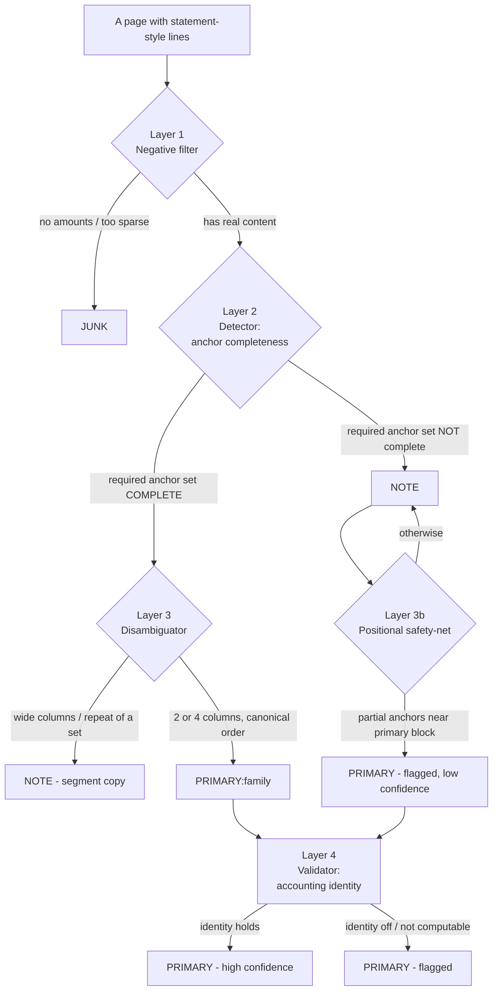

# Primary Financial-Statement Classification

**Separating the *real* financial statements from notes and junk pages**

| | |
|---|---|
| **Component** | `diagnose_pages.py` + `anchors.yaml` |
| **Input** | Raw OCR-provider JSON (same source as Stage 1) |
| **Output** | `page_diagnostics.json` (per-page signals & class) |
| **Audience** | Python developers & business stakeholders |
| **Status** | Validated on the reference sample (69 statement-bearing pages) |
| **Related** | [`OCR_Table_Reconstruction.md`](OCR_Table_Reconstruction.md) — Stage 1 (row/column reconstruction) |

> **Where this fits.** Stage 1 (`OCR_Table_Reconstruction.md`) rebuilds the **tables** —
> rows, columns, account types. **This document is Stage 2:** given those pages, decide which
> ones are *primary* financial statements (Balance / Income / Cash-Flow) and which are merely
> **notes**, **segment tables**, or **junk**. Stage 2 is a **labelling layer** — it never deletes
> data; it tags each page so the business can filter later.

---

## Table of Contents

1. [Executive Summary](#1-executive-summary) *(business)*
2. [The Problem: Why Page Labels Lie](#2-the-problem-why-page-labels-lie)
3. [Strategy Overview — Four Layers](#3-strategy-overview--four-layers)
4. [The Anchor Lexicon (`anchors.yaml`)](#4-the-anchor-lexicon-anchorsyaml) *(business + developers)*
5. [Name Matching: How We Avoid the Trap](#5-name-matching-how-we-avoid-the-trap) *(developers)*
6. [The Signals We Compute Per Page](#6-the-signals-we-compute-per-page)
7. [The Classification Layers in Detail](#7-the-classification-layers-in-detail)
8. [Special Case: The Balance Sheet Spans Two Pages](#8-special-case-the-balance-sheet-spans-two-pages)
9. [Results on the Reference Sample](#9-results-on-the-reference-sample)
10. [How to Run](#10-how-to-run) *(developers)*
11. [Design Decisions & Open Items](#11-design-decisions--open-items)
12. [Glossary](#12-glossary)

---

## 1. Executive Summary

A single OCR document can be **170+ pages**, but only a handful are the actual financial
statements. The rest are **explanatory notes** (Notas explicativas), **segment breakdowns**, cover
pages, and blank pages. Worse, the OCR provider tags individual lines by *what they look like*, not
*where they are* — so the same "balance-sheet-style" line appears on dozens of note pages.

**This component decides, page by page, what each page really is** — and does so *transparently*:
every verdict comes with the signals and reasons behind it, so an analyst can audit it.

The result for each page is a **class** plus supporting evidence:

| Class | Meaning |
|---|---|
| `PRIMARY:BALANCE` / `PRIMARY:INCOME` / `PRIMARY:CASH_FLOW` | A real, primary financial statement |
| `NOTE` | An explanatory note or segment table (may even look complete) |
| `JUNK_no_amounts` / `JUNK_sparse` | No figures, or too few to be a statement |

**Headline result on the reference document:** of **69** pages that carry statement-style lines,
only **6** are primary statements; **54** are notes and **9** are junk.

| What the OCR provider implied | What is actually primary |
|---|---|
| 42 pages tagged "cash flow" | **1** real cash-flow statement (page 26) |
| 10 pages tagged "balance — assets" | **1** real balance sheet (pages 20–21) |
| 24 pages tagged "income" | **3** primary income pages (22, 46, 47) |

**Why this can be trusted.** Detection is driven by **anchor completeness** — a page is only a
primary statement if it carries the *full set* of the statement's defining total lines (e.g. a real
cash-flow statement has **all three** activity sections). This single principle separated the 1 real
cash-flow page from the 41 notes that merely mention a cash-flow-style line. The rules live in a
**human-editable lexicon** (`anchors.yaml`) that business analysts own.

---

## 2. The Problem: Why Page Labels Lie

The OCR provider assigns each line a group such as `BALANCE_ASSETS_LST` or `CASH_FLOW_LST`. It is
crucial to understand what that tag means:

> **The group tag classifies the *content* of a line, not the *location* of a table.**
> A line whose text reads like a cash-flow item gets `CASH_FLOW_LST` — **whether it sits on the real
> cash-flow statement or is merely referenced inside a note.**

The reference document makes this concrete:

| Group tag | Pages carrying it | Pages that are the *real* statement |
|---|---|---|
| `BALANCE_ASSETS_LST` | 10 | 1 balance sheet (across pages 20–21) |
| `CASH_FLOW_LST` | **42** | **1** (page 26) |
| `INCOME_STATEMENT_LST` | 24 | a small primary set (22, 46, 47) |

**Consequence for design:** we must **not** trust the group tag to decide whether a page is a
primary statement. We need an independent signal. Since the OCR output contains **no page titles**
(there is no "Balanço Patrimonial" header element to rely on), that signal has to come from the
**line-item names themselves** — specifically, the **total / result lines** that every real
statement must contain.

---

## 3. Strategy Overview — Four Layers

Classification is a pipeline of layers, cheap-to-expensive, each adding evidence
(Layer 3 has two parts: a column/repeat disambiguator and a positional safety-net):



| Layer | Role | Signals |
|---|---|---|
| **1. Negative filter** | kill obvious junk early | no amounts; very few values; only names; only amounts |
| **2. Detector** | find statement-like pages | **completeness of the anchor (total-line) set** + density + vertical span |
| **3. Disambiguator** | primary vs. segment copy | **column count**, page order, repeated anchor set |
| **3b. Positional safety-net** | recover a statement OCR *almost* completed | **canonical sequence** + partial anchors near a real primary block |
| **4. Validator** | raise/flag confidence | accounting identity (e.g. *Assets = Liabilities + Equity*) |

The **detector (Layer 2)** is the workhorse; the others remove false positives, recover
near-misses, and grade confidence.

---

## 4. The Anchor Lexicon (`anchors.yaml`)

`anchors.yaml` is the **single source of truth** for what defines a primary statement. It is plain
YAML so **business analysts can edit it without touching code**.

### What an "anchor" is

An **anchor** is a *total* or *result* line that a genuine statement must contain — e.g.
`Total do ativo`, `Receita operacional líquida`, the three `Caixa líquido das atividades …` lines.
Their **presence as a complete set** is what distinguishes a real statement from a note.

### Structure (abridged)

```yaml
match_threshold: 85                      # fuzzy backstop for OCR typos
stopwords: [de, do, da, dos, das, e, ...]      # ignored in token comparison
benign_insertions: [utilizado, gerado, prejuizo, ...]   # allowed extra words

statements:
  BALANCE:
    source_groups: [BALANCE_ASSETS_LST, BALANCE_LIABILITIES_LST]
    required_anchors:                    # ALL must be present (across 2 pages)
      - id: total_ativo
        canon: "Total do ativo"
        aliases: ["Total dos ativos"]
      - id: total_passivo_pl
        canon: "Total do passivo e patrimônio líquido"
    identity:
      equation: "total_ativo == total_passivo_pl"
      tolerance_pct: 0.5

  CASH_FLOW:
    required_anchors:                    # the strongest signal: ALL THREE sections
      - id: cf_operacional
        canon: "Caixa líquido das atividades operacionais"
        aliases: ["Caixa líquido (utilizado) gerado nas atividades operacionais", ...]
      - id: cf_investimento
        canon: "Caixa líquido das atividades de investimentos"
      - id: cf_financiamento
        canon: "Caixa líquido das atividades de financiamentos"
```

| Field | Meaning |
|---|---|
| `required_anchors` | The set that must be **fully present** for the page to be a primary candidate. |
| `aliases` | Real OCR variants of the same line (synonyms, parentheticals). |
| `optional_anchors` | Boost confidence / locate sections, but not required. |
| `identity` | An accounting equation used by Layer 4 to grade confidence. |
| `benign_insertions` | Words allowed to appear *inside* a canonical phrase without breaking the match (see §5). |
| `stopwords` | Portuguese function words removed before comparison. |

### Why each anchor carries its **own** full canonical phrase

A word such as `investimentos` is **foreign** to `Total do ativo` but is a **required** part of the
cash-flow investing section. A word is not globally "good" or "bad" — its meaning depends on the
anchor it is tested against. Therefore every entry stores its own complete canonical token set; the
matcher is always *relative to a specific anchor*. This is the key idea that makes matching robust.

---

## 5. Name Matching: How We Avoid the Trap

Matching OCR'd line names against the lexicon is the single place this system could "fall on its
face". A naïve fuzzy threshold **fails badly**, and we proved it on real data.

### The trap: `token_set_ratio` scores subtotals as perfect matches

| Compared against `Total do ativo` | `ratio` | `token_set_ratio` | Correct verdict |
|---|---|---|---|
| `Total do ativo` | 100 | 100 | match ✅ |
| `Total do ativo **circulante**` (a **subtotal**) | 71.8 | **100** ⚠️ | **must NOT match** |
| `Total do ativo **não circulante**` (a **subtotal**) | 65.1 | **100** ⚠️ | **must NOT match** |

`token_set_ratio` ignores "extra" words, so any subtotal that *contains* the total's words scores
100. A naïve `token_set_ratio >= 90` would classify **segment subtotals as the balance total** —
exactly the failure we set out to avoid.

### The robust rule — token coverage relative to each anchor

A line matches an anchor **if and only if** all three hold:

1. **Coverage** — every *significant* token of the anchor's canonical phrase is present in the line.
2. **No foreign tokens** — every *extra* token in the line is in `benign_insertions`. Any other
   significant extra word (`circulante`, `segmento`, …) is a **narrowing qualifier** → **reject**.
3. **Fuzzy backstop** — `token_sort_ratio >= match_threshold` (default 85) to absorb OCR typos.

All comparison happens **after normalization**:

```
"Receita operacional líquida (Nota 30)"
   → strip accents      → "receita operacional liquida (nota 30)"
   → drop "(Nota 30)"   → "receita operacional liquida"
   → drop punctuation, stopwords → tokens {receita, operacional, liquida}
```

### Proof on real corpus variants

| Line (normalized) | Anchor | Verdict | Why |
|---|---|---|---|
| `lucro liquido prejuizo do exercicio` | `Lucro líquido do exercício` | **match** ✅ | `prejuizo` is a benign insertion |
| `caixa liquido utilizado gerado nas atividades operacionais` | cash-flow operating | **match** ✅ | `utilizado`, `gerado` benign |
| `receita operacional liquida` (+ `(Nota 30)`) | `Receita operacional líquida` | **match** ✅ | note ref stripped |
| `total do ativo circulante` | `Total do ativo` | **reject** ✅ | `circulante` is a foreign (narrowing) token |
| `…atividades operacionais` | cash-flow **investing** anchor | **reject** ✅ | `investimentos` missing → not the investing section |

### Tooling

Matching uses **`rapidfuzz`** (installed, v3.14.5) for speed and quality, with an automatic
fallback to Python's standard-library **`difflib`** if the package is unavailable — so the code runs
everywhere, just slightly less sharply without `rapidfuzz`.

---

## 6. The Signals We Compute Per Page

For every page that carries statement-style lines, `diagnose_pages.py` computes:

| Signal | Field | What it tells us |
|---|---|---|
| **Row count** | `n_rows` | How many named line-items — primary statements are dense (15–70). |
| **Amount count** | `n_amounts` | Total figures on the page; `0` ⇒ junk. |
| **Column count** | `n_cols` | Distinct vertical amount-bands. **2 or 4 ⇒ primary-like; many ⇒ segment note.** |
| **Vertical span** | `vspan` | Top-to-bottom coverage (0–1). A real statement fills the page (≈ 0.5+). |
| **Anchors hit** | `anchors` | Which required total-lines were found, per statement family. |
| **Completeness** | `complete` | Which families have their **full** required anchor set. |
| **Identity** | `identity` | Whether the accounting equation holds (when computable). |
| **Provisional class** | `provisional_class` | The page verdict (preview; the production classifier refines it). |

Column count is computed by clustering amount **x-centers** into vertical bands (gap > 0.04). On the
reference sample, primary statements show **2 or 4** bands (Controladora/Consolidado × current/prior),
while segment notes spread into **6–9** bands (page 51 → 7, page 132 → 9).

---

## 7. The Classification Layers in Detail

### Layer 1 — Negative filter

Removes pages that cannot be a statement, cheaply:

- `n_amounts == 0` → `JUNK_no_amounts` (cover pages, text-only pages).
- `n_rows <= 2 and n_amounts <= 3` → `JUNK_sparse` (a stray figure or two).

### Layer 2 — Detector (anchor completeness)

The core test. For each statement family, check whether its **`required_anchors` set is fully
present** on the page (for BALANCE, across adjacent pages — see §8). Completeness, not mere presence
of *one* anchor, is what makes the signal sharp:

> A note that mentions a single `Caixa líquido …` line has **one** of the three sections — it fails
> completeness. The real cash-flow page has **all three** — it passes. This alone reduced 42
> candidate pages to **1**.

### Layer 3 — Disambiguator (primary vs. segment copy)

Some notes — especially **segment breakdowns** — reproduce a *complete* statement and would pass
Layer 2. They are separated by:

1. **Column count** — a primary statement has 2 or 4 amount columns; a segment note fans out into
   many (page 51 → 7, page 132 → 9). `n_cols > 4` ⇒ tag as `NOTE_segment` even if complete.
2. **Page order** — the primary block appears earlier and in canonical order
   (Balance → Income → Cash-Flow); later complete copies are notes.
3. **Repeated anchor set** — the same complete set appearing a second time marks the first as
   primary and the rest as notes (unless they are a legitimate Individual vs. Consolidado split —
   see §11).

### Layer 3b — Positional safety-net (sequence-based recovery)

A deliberately **conservative** recovery step for the case where OCR mangled one anchor line so a
real statement *just* failed completeness in Layer 2. It exploits the fact that primary statements
appear as a **block in canonical order** (Balance → Income → Cash-Flow): if the block is solid but
one family is missing, a nearby strong-but-incomplete page is very likely that missing statement.

It promotes such a page to `PRIMARY` only when **all** of these hold:

1. **A real block exists** — at least `POSITIONAL_MIN_PRIMARY_FAMILIES` (= 2) families are already
   primary. With no trustworthy block, nothing is inferred.
2. **The family is still missing** — it has no primary page yet.
3. **Partial anchor evidence** — the candidate carries **≥ 1** of the family's required anchors.
   *Promotion never happens on column layout alone* — this is what prevents "any note with columns"
   from being mislabelled.
4. **Right position & shape** — within `POSITIONAL_BLOCK_RADIUS` (= 4) pages after the block, with a
   primary-like column count (≤ 4).

Promoted pages are marked `needs_review: true` with **low confidence** (0.55) and a full reason in
`reasons`, so the inference is explicit and auditable — never a silent guess.

> **Why a safety-net, not a detector.** Inferring a statement purely from position ("the next page
> with N/N-1 columns") would mislabel the many notes that follow the primary block. Requiring
> partial anchor evidence keeps recovery tied to real content. Verified: when cash-flow anchors are
> intact, this layer makes **no** changes; when one of the three cash-flow sections is corrupted, it
> correctly recovers the page as a flagged primary.

### Layer 4 — Validator (accounting identity)

Raises or flags confidence without ever discarding data:

- **Balance:** does the `Total do ativo` figure equal `Total do passivo e patrimônio líquido`
  (within `tolerance_pct`, accounting for `milhares` rounding)? Brazilian number format is parsed
  here: `"6.886.721"` → `6886721`, `"(106.057.746)"` → negative.
- **Cash flow:** does *opening + net change = closing*?

Identity **holding** → high confidence. Identity **off or not computable** → the page stays
`PRIMARY` but is **flagged** (OCR may have misread a digit; we never reject on this alone). This
mirrors the `needs_review` philosophy from Stage 1.

---

## 8. Special Case: The Balance Sheet Spans Two Pages

This is a structural fact of Brazilian financial reports that the diagnostic surfaced — and a good
illustration of *why* we validate against data rather than assumptions.

A Brazilian balance sheet is printed across **two facing pages**:

```
   Page 20                         Page 21
   ─────────────────────           ─────────────────────────────────
   ATIVO (assets)                  PASSIVO + PATRIMÔNIO LÍQUIDO
   …                               …
   Total do ativo  ◄── anchor      Total do passivo e patrimônio líquido  ◄── anchor
```

An early version of the rule required **both** balance anchors on **one** page — so it matched
**nowhere**, even though the balance sheet is obviously present on 20–21. The fix:

> **BALANCE completeness is evaluated across adjacent pages** (`page`, `page ± 1`). A page is a
> primary balance page if it carries one balance side **and** the full required set is satisfied
> across it and its neighbours.

After the fix, pages 20 and 21 are both correctly classified `PRIMARY:BALANCE`. Income and
cash-flow statements remain single-page.

---

## 9. Results on the Reference Sample

### Distribution

| Class | Pages |
|---|---|
| `PRIMARY` | **6** |
| `NOTE` | 54 |
| `JUNK_no_amounts` | 8 |
| `JUNK_sparse` | 1 |
| **Total (statement-bearing pages)** | **69** |

### The primary statements found

| Page | Class | Cols | Rows | vspan | Note |
|---|---|---|---|---|---|
| 20 | `PRIMARY:BALANCE` | 4 | 35 | 0.497 | Assets side |
| 21 | `PRIMARY:BALANCE` | 4 | 38 | 0.532 | Liabilities + equity side |
| 22 | `PRIMARY:INCOME` | 4 | 28 | 0.528 | Consolidated income statement |
| 26 | `PRIMARY:CASH_FLOW` | 4 | 71 | 0.671 | All three activity sections present |
| 46 | `PRIMARY:INCOME` | 2 | 19 | 0.309 | Income (2-column — Individual/Consolidado split?) |
| 47 | `PRIMARY:INCOME` | 2 | 18 | 0.309 | Income (2-column) |

### The canonical sequence is visible

```
page 20 → Total do ativo                          ┐
page 21 → Total do passivo e patrimônio líquido   ┘ BALANCE
page 22 → Receita líquida … Lucro líquido           INCOME
   …
page 26 → 3× Caixa líquido das atividades …         CASH FLOW
```

Balance → Income → Cash-Flow, in order — exactly the sequence used by the disambiguator.

### Segment notes correctly rejected

Pages 49 (6 columns), 51 (7), 132 (9) carry statement-style content but fan into many columns —
all classified `NOTE`, not primary.

---

## 10. How to Run

**Requirements:** Python 3.13, `pyyaml` (installed). `rapidfuzz` optional (installed; falls back to
`difflib`).

```bash
# Diagnose the reference sample (read-only — modifies nothing)
python3.13 diagnose_pages.py

# Diagnose another document
python3.13 diagnose_pages.py path/to/other.json
```

**Outputs**

- Console: a per-page table + summary (primary pages, completeness per family).
- `page_diagnostics.json`: the full per-page signals for downstream tooling.

**Editing the lexicon** — to add an anchor variant or a new alias, edit `anchors.yaml` and re-run;
no code change required. Tunable knobs:

| Where | Knob | Effect |
|---|---|---|
| `anchors.yaml` | `match_threshold` | Fuzzy strictness (higher = stricter). |
| `anchors.yaml` | `benign_insertions` | Words allowed inside a canonical phrase. |
| `anchors.yaml` | `required_anchors` | What makes a family "complete". |
| `diagnose_pages.py` | x-band `gap` (0.04) | Column-count sensitivity. |
| `classify_statements.py` | `POSITIONAL_BLOCK_RADIUS` (4) | How many pages after the block Layer 3b searches. |
| `classify_statements.py` | `POSITIONAL_MIN_PRIMARY_FAMILIES` (2) | How solid the block must be before Layer 3b infers. |
| `classify_statements.py` | `POSITIONAL_PROMOTE_CONFIDENCE` (0.55) | Confidence assigned to a safety-net promotion. |

---

## 11. Design Decisions & Open Items

### Decisions made (and why)

| Decision | Rationale |
|---|---|
| **Tag, never delete** | Reversible and auditable; the business filters later per its needs. |
| **Anchors over group tags** | Group tags classify content, not location — they over-count badly. |
| **Completeness over density** | A large note can be dense; only a *full anchor set* marks a real statement. |
| **Per-anchor canonical tokens** | A word's validity depends on the anchor it is tested against. |
| **`rapidfuzz` + `difflib` fallback** | Best quality where available; portable everywhere. |
| **External `anchors.yaml`** | Business owns the lexicon without code changes. |
| **Positional safety-net is a *net*, not a *detector*** | Inferring purely by position would mislabel notes; requiring partial anchors keeps recovery tied to real content, and flags it for review. |

### Validated on a second document

The pipeline was re-run on a different document (`sample_2.json`, 15 statement pages, 2-column,
period 2024/2023). It generalized: BALANCE [7, 8], INCOME [9], CASH_FLOW [13]. Two findings fed
back into the design:

- **Wording variation** — cash-flow sections appeared as *"gerado **pelas** atividades"* and
  *"aplicado **nas** atividades"*. The connecting prepositions blocked the match until `pelas`/`nas`
  were added to `benign_insertions` and the exact phrasings to the section `aliases`. The reference
  document (6 primaries) showed **no regression**.
- **Safety-net verified** — corrupting one of the three cash-flow section lines on page 13 (a
  simulated OCR failure) made Layer 2 fail completeness; Layer 3b then recovered the page as
  `PRIMARY:CASH_FLOW` (confidence 0.55, `needs_review`), citing the 2/3 partial anchors near the
  primary block. With anchors intact, Layer 3b changes nothing.

### Open items for review

1. **Three "complete" income pages (22, 46, 47).** Page 22 is a 4-column consolidated income
   statement; pages 46–47 are 2-column. These are likely an **Individual vs. Consolidado** split
   presented on separate pages (both legitimately primary), or a per-segment income view. Both are
   kept (flagged `needs_review`) pending confirmation.
2. **Anchor lexicon review.** `aliases` and `benign_insertions` are seeded from two documents and
   grow as more are processed (e.g. add *Resultado abrangente* if wanted as a sequence separator).
3. **Threshold calibration.** `match_threshold`, density, column cutoffs, and the positional
   constants are set from two samples; they will be tuned against a small labelled set as testing
   proceeds.

---

## 12. Glossary

| Term | Meaning |
|---|---|
| **Anchor** | A total/result line whose presence (as a set) defines a primary statement. |
| **Completeness** | All `required_anchors` of a family present (for balance, across adjacent pages). |
| **Primary statement** | The real Balance / Income / Cash-Flow table (vs. a note about it). |
| **Note (Nota explicativa)** | Explanatory or segment table; may reproduce statement-style content. |
| **Segment note** | A note that breaks a statement down by business segment — many columns. |
| **Positional safety-net** | Layer 3b: recovers a near-miss statement using canonical sequence + partial anchors near a primary block; flagged, low-confidence. |
| **Narrowing qualifier** | An extra word that turns a total into a subtotal (`circulante`, `segmento`). |
| **Benign insertion** | An extra word that does not change a line's identity (`utilizado`, `prejuízo`). |
| **Controladora / Consolidado** | Parent-only vs. group-consolidated reporting basis (column pairs). |
| **Accounting identity** | An equation a real statement must satisfy (e.g. Assets = Liabilities + Equity). |
| **x-band** | A vertical cluster of amount x-centers = one column. |

---

*Document for the `br_ocr_json_processing` project, Stage 2. Every figure here is reproducible by
running `python3.13 diagnose_pages.py` against the reference sample. See
[`OCR_Table_Reconstruction.md`](OCR_Table_Reconstruction.md) for Stage 1 (table reconstruction).*
